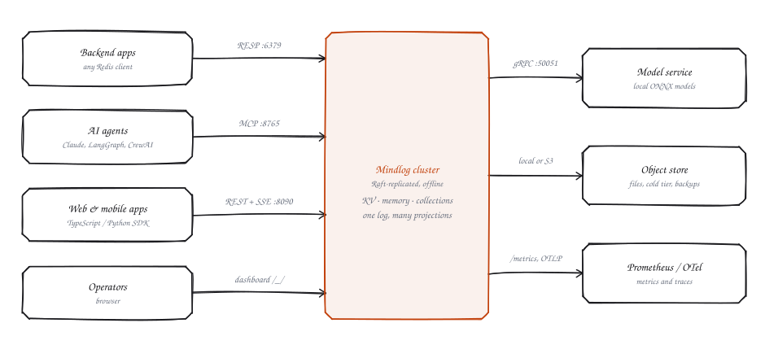
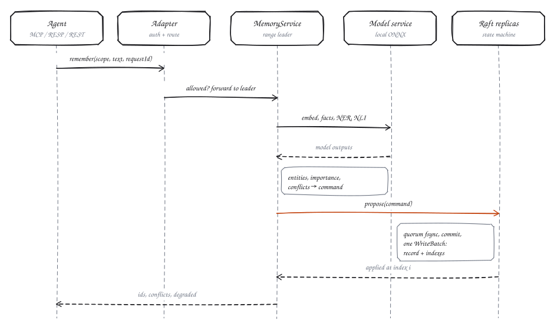

# Mindlog

**A replicated database that is also long-term memory for AI agents.**

Mindlog is one server you can use three ways at once:

- **Key-value store.** It speaks the Redis protocol, so any Redis client (`redis-cli`, `ioredis`, `redis-py`, …) works unchanged. Mindlog does not run or depend on Redis; it implements the protocol itself.
- **Agent memory.** Agents store facts and recall them by meaning, over MCP (Claude Desktop, Claude Code), REST, the `MEM.*` commands or the TypeScript and Python SDKs.
- **App backend** (optional). Collections with access rules, user sign-in, file uploads and realtime updates, in the style of PocketBase.

Every change is a command in a Raft log, copied to several machines before it is acknowledged. Local models (embeddings, fact extraction, entity recognition, contradiction detection, reranking) run in a Python sidecar. Mindlog needs no internet access and no third-party API.

<p align="center">
  
</p>

---

## Contents

- [Features](#features)
- [Quick start](#quick-start)
- [Ways to connect](#ways-to-connect)
- [How it works](#how-it-works)
- [Measured results](#measured-results)
- [Known limits](#known-limits)
- [Repository layout](#repository-layout)
- [Development](#development)
- [Documentation](#documentation)
- [Contributing, security and license](#contributing-security-and-license)

---

## Features

### Agent memory
| Feature | What it does |
|---|---|
| **Remember** | Extracts facts, entities and embeddings from text; stores them append-only with provenance and four timestamps |
| **Recall** | Hybrid search (vectors, BM25 keywords, entities, graph walks), fused, reranked and packed into a token budget. Named recipes: `rag`, `vector`, `hybrid`, `hybrid_ppr`, `full` |
| **Conflict detection** | Each new fact is checked against what the agent already knows *before* it is committed, with a local NLI model; a policy decides what happens |
| **Branches** | An agent tries a plan on a branch of its memory, then merges or drops it |
| **Time travel** | Recall what was known at a past moment (`ASOF`) or what was true in the world at a date (`VALID_AT`) |
| **Trust and provenance** | Untrusted content is quarantined; `FORGET SOURCE` removes everything derived from a bad source |
| **Lifecycle** | Consolidation, deduplication, themes, pinning, forgetting by retention score, cold tier in an object store |
| **Change streams** | Follow a memory scope live over `MEM.WATCH`, SSE or MCP subscriptions |
| **Semantic cache** | Cache answers by meaning; entries are dropped automatically when the memories they used change |
| **Import / export** | Portable `.mcube` archives and tool-call traces |

### Database
- Strings, hashes, lists, sets, sorted sets, JSON, TTLs, `MULTI`/`EXEC`/`WATCH` over RESP2 and RESP3.
- Multi-Raft: data is split into ranges that split and rebalance automatically; a placement driver tracks them.
- Leader failover in under 2 s; no acknowledged write lost under `kill -9`.
- Embedded replicas for offline apps (TypeScript and Python, SQLite file).

### App backend
- Collections with typed fields, views and migrations; a rules language for access control.
- Password, one-time-code and OAuth2 sign-in; file uploads with thumbnails; realtime over SSE; server-side TypeScript hooks and cron.

### Operations
- Tenants with six roles, policy rows, API keys, quotas and an audit log.
- TLS and mTLS with hot reload, encryption at rest, full backups with `verify` and `restore`.
- Prometheus metrics, OpenTelemetry traces, structured logs, 11 runbooks.
- A React dashboard: data browser, console, memory, recall, graph, conflicts, branches, jobs, cluster, tenants and more.

---

## Quick start

**Requirements:** Node.js 24+, pnpm 10 (`corepack enable`). Optional: [uv](https://docs.astral.sh/uv/) for the model service, Docker for clusters.

```bash
git clone https://github.com/VishvakR/Mindlog.git && cd Mindlog
corepack enable && pnpm install && pnpm build
alias mindlog-server="node $PWD/packages/server/dist/bin.js"
```

**1. Create a dashboard account and an API key** (with the node stopped):

```bash
mindlog-server superuser upsert admin@example.com 'a long password' --data-dir ./data
mindlog-server apikey create --tenant default --user ana --name laptop --data-dir ./data
# prints mlk_…  — store it, it is shown once
```

**2. Start a node:**

```bash
mindlog-server --single-node --data-dir ./data
```

| Listener | Address |
|---|---|
| Redis protocol (RESP) | `:6379` |
| REST, SSE, dashboard, metrics | `http://localhost:8090` (dashboard at `/_/`) |
| MCP | `http://127.0.0.1:8765/mcp` |

**3. Store and recall a memory:**

```bash
KEY=mlk_…
curl -s localhost:8090/api/memory/remember -H "Authorization: Bearer $KEY" \
  -H 'content-type: application/json' \
  -d '{"scope":{"user":"ana"},"content":"Ana prefers dark roast coffee, black."}'

curl -s localhost:8090/api/memory/recall -H "Authorization: Bearer $KEY" \
  -H 'content-type: application/json' \
  -d '{"scope":{"user":"ana"},"query":"What coffee does Ana like?","k":3}'
```

The recall response has the ranked `items` (each with a `score` and the signals behind it) and `context`, a text block ready to put in a prompt.

**4. Add the models** (optional, for extraction, embeddings and conflict detection). Without them, memory still works in *degraded mode*: raw text is stored and keyword recall works, and enrichment runs later.

```bash
cd python
uv run --package mindlog-model-service --group download python model_service/scripts/download_models.py   # once
uv run python -m model_service                                     # gRPC on 127.0.0.1:50051
# then restart the node with:
MINDLOG_MODELS__ENDPOINT=127.0.0.1:50051 mindlog-server --single-node --data-dir ./data
```

**Or with Docker:** `docker compose --profile dev up --build` runs one node, the model service, Prometheus, Grafana and Jaeger. `--profile cluster` runs three nodes.

The full walkthrough is in [Quickstart](docs/getting-started.md).

---

## Ways to connect

All interfaces share the same data, permissions and error codes.

| Interface | Address | Use it from |
|---|---|---|
| MCP | `127.0.0.1:8765/mcp` | Claude Desktop, Claude Code, any MCP host (stdio relay: `mindlog-server mcp --api-key mlk_…`). 14 tools: `remember`, `recall`, `forget`, `history`, `conflicts`, `branch_*`, `cache_*`, … |
| REST | `:8090/api/*` | Any HTTP client; OpenAPI spec at `/api/openapi.json` |
| Redis protocol | `:6379` | Any Redis client; `MEM.*`, `CACHE.*` and `CLUSTER.*` commands are sent with the client's generic command call |
| TypeScript SDK | `@mindlog/sdk` | Memory, KV, collections, auth, files, realtime, embedded replica |
| Python SDK | `mindlog.sdk` | Memory, KV, change streams, embedded replica; LangGraph store and checkpointer, CrewAI adapter |
| Dashboard | `:8090/_/` | Browse data, run commands, inspect memories, conflicts and the cluster |

**Claude Desktop** (`claude_desktop_config.json`):

```json
{
  "mcpServers": {
    "mindlog": {
      "command": "node",
      "args": ["/path/to/Mindlog/packages/server/dist/bin.js", "mcp", "--url", "http://127.0.0.1:8765/mcp", "--api-key", "mlk_…"]
    }
  }
}
```

**Python:**

```python
from mindlog.sdk import Client

memory = Client("http://localhost:8090", api_key="mlk_…").memory("ana")
memory.remember("Ana is planning a trip to Lisbon in May.")
print(memory.recall("Where is Ana travelling?", k=3)["context"])
```

**TypeScript:**

```ts
import { MindlogClient, MemoryApi } from '@mindlog/sdk';

const memory = new MemoryApi(new MindlogClient('http://localhost:8090'), 'ana', process.env.MINDLOG_API_KEY);
await memory.remember('Ana is planning a trip to Lisbon in May.');
const { context } = await memory.recall('Where is Ana travelling?', { k: 3 });
```

---

## How it works

<p align="center">
  
</p>

- **The log is the source of truth.** Keys, memories, vector and keyword indexes, the knowledge graph and caches are all deterministic projections of committed Raft commands, so every replica ends up identical.
- **Models run before proposing.** The leader runs the models and puts their outputs into the command; followers never re-run them. Losing the model service lowers quality, not availability.
- **Memories are never overwritten.** Facts are superseded with validity windows and versions, which is what makes time travel and audits possible.
- **Decisions happen at commit time.** Conflict checks, trust classification and cache invalidation are part of the same write, the same on every replica.
- **Layered packages.** Interfaces → application → domain → replication → storage → core; imports only point downward, enforced by lint and tests.

More: [Architecture overview](docs/architecture/overview.md), [System design](docs/design.md), [41 architecture decision records](docs/adr/README.md).

---

## Measured results

From the phase exit gates on one Apple M-series laptop (full table in [SLOs](docs/slo.md)):

| | Result |
|---|---|
| Leader failover | median 1.53 s, max 1.85 s over 30 kills |
| Durability | no acknowledged write lost under `kill -9`, failover, Jepsen Maelstrom `lin-kv` with partitions, or the deterministic simulator |
| Recall, LongMemEval_s (100 questions) | recall_any@10: `hybrid_ppr` 0.94 vs `vector` 0.87 |
| Recall, LoCoMo (1,535 questions) | recall_any@10: `full` 0.712, `hybrid` 0.613, `vector` 0.525 |
| Recall latency, 10K memories | `hybrid_ppr` p95 43 ms with real models |
| Conflict detection | F1 0.92 on 320 labelled pairs |
| Semantic cache | 1.4% false hits at similarity 0.92 |

Each feature has prior art (Graphiti, Cognee, Letta, GPTCache, Redis Agent Memory Server and others); Mindlog's contribution is the **combination inside one replicated, multi-agent database with decisions made at commit time**. The comparison is in [Why Mindlog](docs/overview/why-mindlog.md).

---

## Known limits

- The vector index is an exact flat index per memory scope: simple and deterministic, but linear in scope size.
- Cluster membership changes are single-server, not joint consensus.
- Backups are full snapshots; no point-in-time restore yet.
- The default `full` recall recipe (cross-encoder rerank) is the most accurate but slow at p95; use `recipe: hybrid` when latency matters.
- The TypeScript SDK is not on npm yet; install it from the workspace or the release tarball.

---

## Repository layout

```
packages/     TypeScript packages, one per module: core, storage, raft, multiraft, pd, statemachine,
              kv, txn, memory, consolidation, branching, cache, collections, rules, auth, services,
              adapter-resp, adapter-http, adapter-mcp, sdk-ts, server, …
python/       uv workspace: model_service (ONNX models over gRPC), sdk, evals, demo_agents, compat
proto/        protobuf schemas (buf), package mindlog.v1
web/          dashboard (React + shadcn/ui)
examples/     todo-app built on the app backend
test/         simulator, integration, Maelstrom, chaos, compatibility tests
deploy/       Prometheus, Grafana and compose configuration
docs/         the documentation book (GitBook), ADRs, runbooks, evals
```

---

## Development

```bash
pnpm lint && pnpm typecheck && pnpm test     # what CI runs for TypeScript
pnpm dev                                     # one node + dashboard on :8090/_/
scripts/sim.sh <seeds> <shards>              # deterministic simulator
pnpm test:durability                         # kill -9 under load loses nothing acknowledged
cd python && uv sync && uv run pytest        # Python
docker compose --profile cluster up          # 3 nodes + PD + MinIO + Prometheus + Grafana + Jaeger
```

---

## Documentation

The full documentation lives in [`docs/`](docs/README.md) and is published with GitBook:

| | |
|---|---|
| Getting started | [Installation](docs/getting-started/installation.md) · [Quickstart](docs/getting-started.md) · [Connect an AI agent](docs/getting-started/connect-an-agent.md) · [Models](docs/getting-started/models.md) · [Deployment](docs/getting-started/deployment.md) |
| Guides | [Agent memory](docs/guides/memory/README.md) · [Key-value store](docs/guides/kv.md) · [Semantic cache](docs/guides/semantic-cache.md) · [App backend](docs/guides/app-backend/README.md) · [Tenants and access](docs/guides/tenants-and-access.md) |
| SDKs | [TypeScript](docs/sdks/typescript.md) · [Python](docs/sdks/python.md) · [LangGraph](docs/sdks/langgraph.md) · [CrewAI](docs/sdks/crewai.md) · [Redis clients](docs/sdks/redis-clients.md) |
| Reference | [RESP commands](docs/api/resp-compatibility.md) · [MCP tools](docs/api/mcp-tools.md) · [HTTP API](docs/api/http.md) · [CLI](docs/reference/cli.md) · [Configuration](docs/reference/configuration.md) · [Errors](docs/reference/errors.md) · [Metrics](docs/reference/metrics.md) |
| Operations | [Security](docs/operations/security.md) · [Backups](docs/operations/backups.md) · [Observability](docs/operations/observability.md) · [Runbooks](docs/runbooks/README.md) |

---

## Contributing, security and license

- Contributions: see [CONTRIBUTING.md](CONTRIBUTING.md).
- Vulnerabilities: see [SECURITY.md](SECURITY.md); please do not open public issues for them.
- Changes per release: [CHANGELOG.md](CHANGELOG.md).
- Mindlog is released under the [MIT license](LICENSE). Third-party notices are in [THIRD_PARTY_NOTICES.md](THIRD_PARTY_NOTICES.md).
