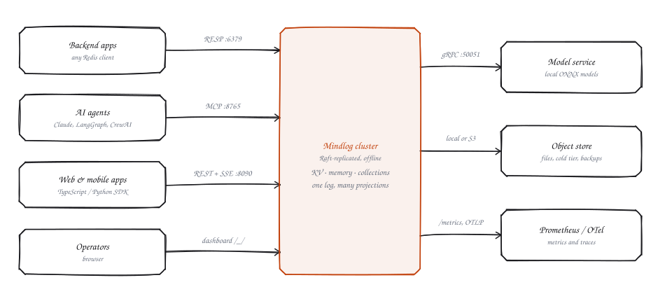

# Introduction

**Mindlog** is a database you can use in three ways, all at once, from one cluster:

* as a **Redis-compatible key-value store**: any Redis client works over RESP2/RESP3;
* as **long-term memory for AI agents**: agents connect over the Model Context Protocol (MCP), the `MEM.*` Redis commands or REST;
* as an **app backend**, in the style of PocketBase: collections with access rules, user sign-in, file uploads and realtime updates.

Every change is a command in a replicated Raft log. Keys, memories, vector and keyword indexes, the knowledge graph and caches are deterministic projections of that log, so every replica holds the same state and survives the loss of a minority of nodes. Models (embeddings, fact extraction, entity recognition, contradiction detection, reranking) run locally in a Python sidecar. Mindlog needs no network access and no third-party API.

<figure><figcaption>
Who talks to Mindlog, and what Mindlog talks to.
</figcaption></figure>

## What you can do with it

<table data-view="cards"><thead><tr><th></th><th></th><th data-hidden data-card-target data-type="content-ref"></th></tr></thead><tbody><tr><td><strong>Give agents a memory</strong></td><td>Store facts, preferences and decisions. Recall them with hybrid search (vectors, BM25, entities, graph walks) packed into a token budget.</td><td><a href="guides/memory/README.md">README.md</a></td></tr><tr><td><strong>Catch contradictions</strong></td><td>New facts are checked against what the agent already knows before they are committed; conflicts follow a policy you choose.</td><td><a href="guides/memory/conflicts.md">conflicts.md</a></td></tr><tr><td><strong>Branch and time-travel</strong></td><td>Let an agent try a plan on a memory branch and merge it back, or recall exactly what was known at a past moment.</td><td><a href="guides/memory/branches.md">branches.md</a></td></tr><tr><td><strong>Use it as Redis</strong></td><td>Strings, hashes, lists, sets, sorted sets, JSON, TTLs and transactions, replicated with Raft.</td><td><a href="guides/kv.md">kv.md</a></td></tr><tr><td><strong>Build an app on it</strong></td><td>Collections with rules, password/OTP/OAuth2 sign-in, files and realtime, from the TypeScript SDK.</td><td><a href="guides/app-backend/README.md">README.md</a></td></tr><tr><td><strong>Run it in production</strong></td><td>Multi-Raft scaling, tenants with RBAC and quotas, TLS, encryption at rest, backups and runbooks.</td><td><a href="operations/security.md">security.md</a></td></tr></tbody></table>

## Start here


New to Mindlog? Read [Key concepts](overview/concepts.md), then follow the [Quickstart](getting-started.md). It takes about ten minutes and needs only Node.js and pnpm.


| I want to… | Go to |
|---|---|
| Install Mindlog and run one node | [Installation](getting-started/installation.md), [Quickstart](getting-started.md) |
| Give Claude Desktop, Claude Code or my own agent a memory | [Connect an AI agent](getting-started/connect-an-agent.md) |
| Use Mindlog from TypeScript or Python | [TypeScript SDK](sdks/typescript.md), [Python SDK](sdks/python.md) |
| Plug it into LangGraph or CrewAI | [LangGraph](sdks/langgraph.md), [CrewAI](sdks/crewai.md) |
| Look up a command, tool, endpoint or setting | [Reference](api/resp-compatibility.md) |
| Understand how it works inside | [Architecture overview](architecture/overview.md) |
| Operate a cluster | [Deployment](getting-started/deployment.md), [Runbooks](runbooks/README.md) |

## Interfaces at a glance

| Interface | Default address | Used by |
|---|---|---|
| RESP2 / RESP3 | `:6379` | Any Redis client, `redis-cli`, `MEM.*` and `CACHE.*` commands |
| MCP (Streamable HTTP) | `127.0.0.1:8765/mcp` | Claude Desktop, Claude Code and other MCP hosts; a stdio relay is included |
| HTTP: REST, SSE, OpenAPI | `:8090/api/*` | SDKs, web and mobile apps, scripts |
| Dashboard | `:8090/_/` | Operators and developers |
| Metrics | `:8090/metrics` | Prometheus |

## Project status

Mindlog 1.0.0 is a complete system built in eleven phases, each closed by a measured exit gate. The [SLO page](slo.md) lists what was measured and what was not; the [design write-up](blog/design-writeup.md) lists the known limits. Mindlog is released under the [MIT license](https://github.com/VishvakR/Mindlog/blob/main/LICENSE).
