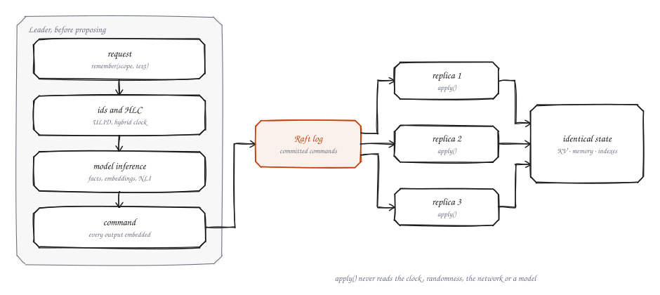
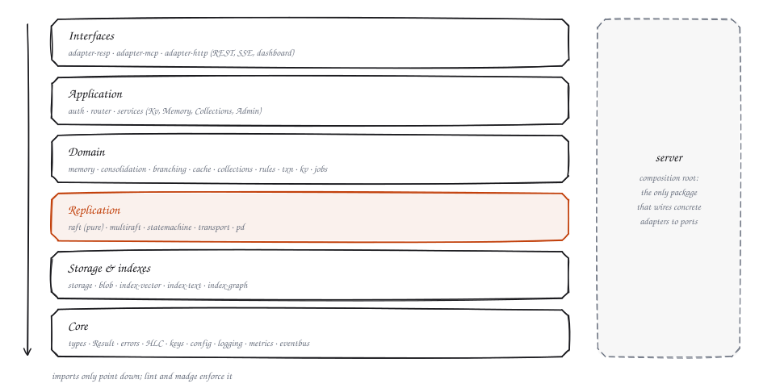
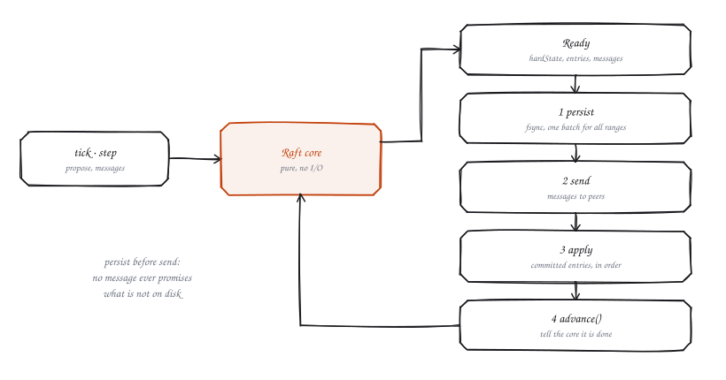
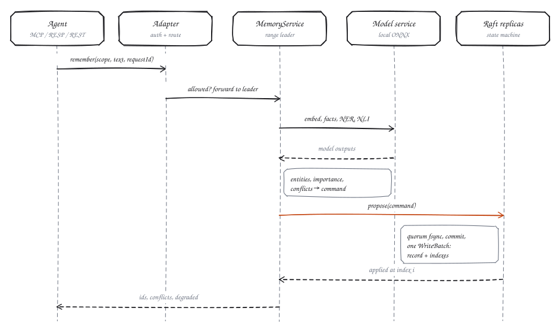
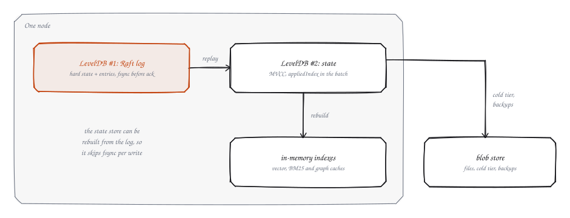
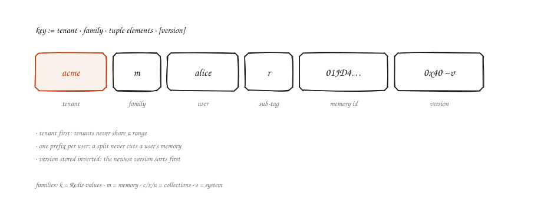

# Architecture overview

This page explains how Mindlog works inside, at the level you need to operate it or reason about its guarantees. The [System design](../design.md) document goes deeper, and every major decision has an [ADR](../adr/README.md).

## The central idea: one log, many projections

Every state change (a Redis `SET`, a memory commit, a conflict resolution, a branch merge, a cache entry, a collection record, a job lease) is a **command in a Raft log**. Key-value data, memory records, the vector, keyword and graph indexes, caches and collection indexes are all **deterministic projections** of the committed commands.

<figure><figcaption>
Non-deterministic work happens once, before proposing; replicas only apply.
</figcaption></figure>

Anything non-deterministic (ids, timestamps, randomness, model inference) happens **once, on the leader, before proposing**, and its outputs are written into the command. `apply()` never reads the clock, randomness, the network or a model. So:

* every replica ends up in exactly the same state;
* followers never re-run models;
* a deterministic simulator can replay a whole cluster from a seed;
* recovery is replaying the log from the last applied index.

## Layers

<figure><figcaption>
Imports only point down; lint and a cycle checker enforce it.
</figcaption></figure>

The code is one package per module, in six layers. **Adapters** (RESP, MCP, HTTP) only parse, validate, call a service and serialise. **Services** authorize and route. The **domain** packages (memory, branching, cache, collections, rules, transactions, KV, jobs) hold the business rules and declare **ports** (interfaces) for what they need. Infrastructure implements those ports, and the `server` package wires the concrete adapters together. This is enforced: domain code cannot import LevelDB, gRPC, Fastify or the filesystem.

## Replication

<figure><figcaption>
The replica loop: persist before send.
</figcaption></figure>

* The **Raft core** is a pure state machine (Ready / advance, after etcd's design): PreVote, CheckQuorum, leader leases, ReadIndex, snapshots, learners, single-server membership changes and leadership transfer.
* **Persist before send.** Hard state and entries are fsynced, in one batch for all ranges on the node, before any message that depends on them is sent. Committed entries are applied in order.
* **Multi-Raft.** The keyspace is cut into **ranges**, each its own Raft group. Ranges split, merge and move. A node hosts many replicas behind one tick timer, idle ranges stop ticking, and heartbeats are coalesced.
* The **placement driver** (a Raft group of its own, range 0) keeps the range directory, issues unique ids and timestamps, and schedules repairs, splits, merges and rebalancing, with an explanation for each decision.
* **Time.** Hybrid logical clocks order commands. A node whose clock drifts beyond `cluster.maxClockOffsetMs` fences itself rather than risk serving a stale lease.

## The write path

<figure><figcaption>
One <code>remember</code> call.
</figcaption></figure>

Any node accepts any request. It is authorized, routed to the leader of the range that owns the key (forwarded over `:7000` if remote), enriched by models on the leader, proposed, replicated to a quorum, and applied in one write batch on each replica. The reply goes back only after apply. Change events and cache invalidations are emitted after apply.

## Reads and consistency

| Level | How it is served | Used by |
|---|---|---|
| `lease` | The leader answers locally while its lease holds | Ordinary reads (default) |
| `linearizable` | ReadIndex: the leader confirms leadership with a quorum, waits until applied ≥ that index | `WATCH`/`EXEC`, admin |
| `bounded_staleness` | A replica answers if its applied state is fresh enough, otherwise ReadIndex | Opt-in reads |
| `snapshot(t)` | An MVCC read at a past version | `ASOF` recall |

## Storage

<figure><figcaption>
What one node keeps.
</figcaption></figure>

* **Two LevelDB instances per node.** The Raft log is fsynced. The state store skips fsync per write, because the applied index is written in the same batch and a restart replays the log from there. The log is never compacted past what the state store has durably flushed.
* **MVCC.** Versions are per-range HLC timestamps. Deletes write tombstones; garbage collection is a replicated command (7 days for KV, 30 for memory by default). Branch fork points pin their versions.
* **Keys** use an order-preserving tuple encoding, with the tenant first:

<figure><figcaption>
Anatomy of a key.
</figcaption></figure>

* **Indexes** (exact flat vector index per scope, BM25 postings, entity graph, collection secondary and unique indexes) are updated inside apply, so they never disagree with committed data, and can be rebuilt from records.
* **Blob store** (local or S3) holds files, the memory cold tier and backups.

## Failure handling

| Failure | Behaviour |
|---|---|
| A node dies | Its leaderships move within ~2 s (measured median 1.53 s); the PD re-replicates after `deadAfterMs` |
| A minority partition | The majority side keeps serving; the minority refuses writes and lease reads |
| Model service down | Memory degrades: raw writes, enrichment jobs, keyword/entity recall, `degraded: true` |
| PD unavailable | The data path continues with the cached range map; splits, moves and new timestamps pause |
| Disk or corruption error in apply | The replica fail-stops instead of skipping an entry; others continue |
| Clock drift | The node fences itself (`CLOCK_OFFSET_EXCEEDED`) |

## How it is tested

A deterministic simulator runs whole clusters from seeds with network faults, crashes and clock skew, checking invariants. Jepsen's Maelstrom checks `lin-kv` linearizability under partitions. Failover, kill -9 durability, RESP compatibility (ioredis, redis-py), parser fuzzing, authorization matrices, cross-tenant fuzzing and memory-quality evals (LongMemEval, LoCoMo) all run as tests. Results are on the [SLO page](../slo.md) and the [evaluations](../evals/README.md) page.
