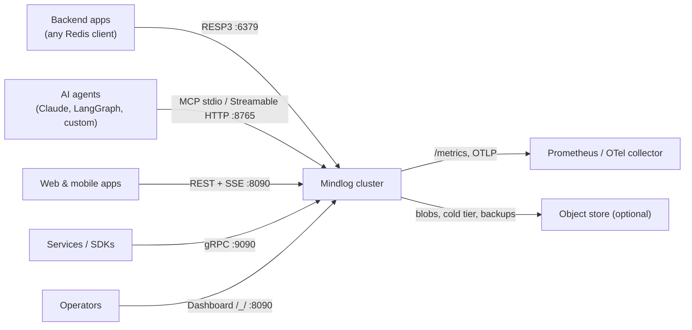
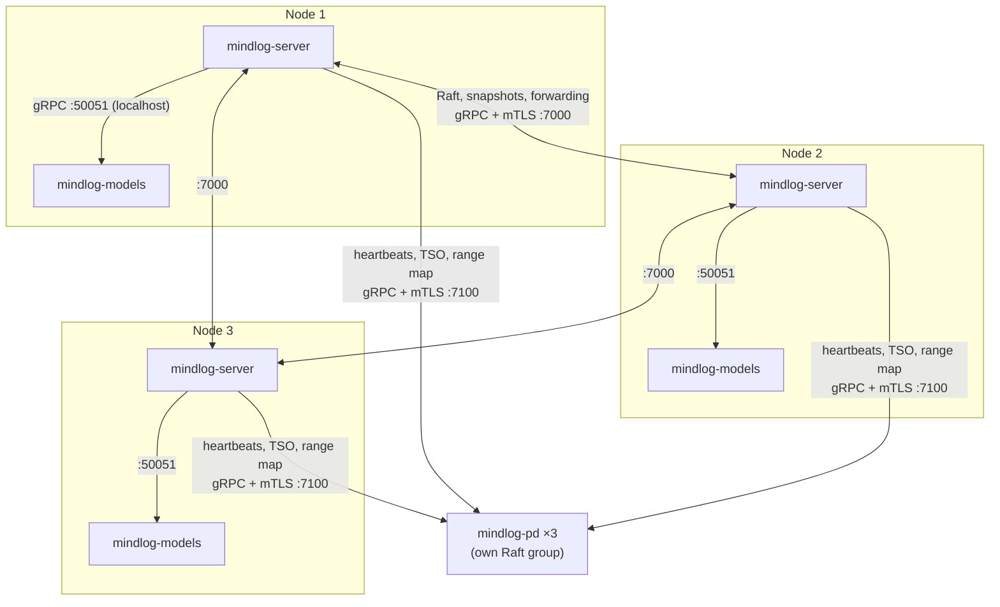
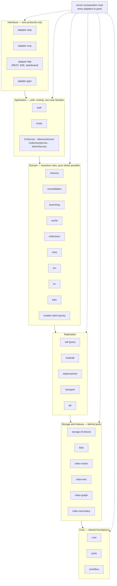
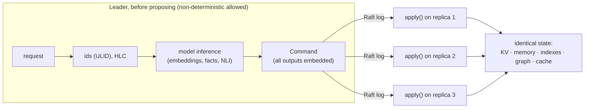
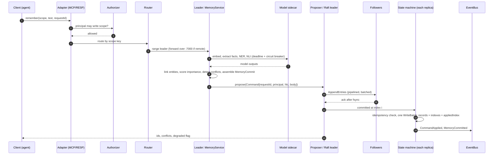
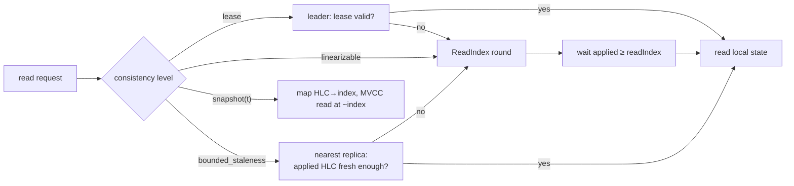
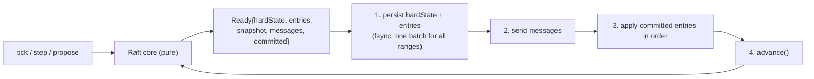
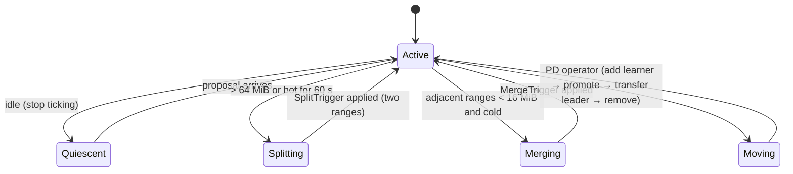
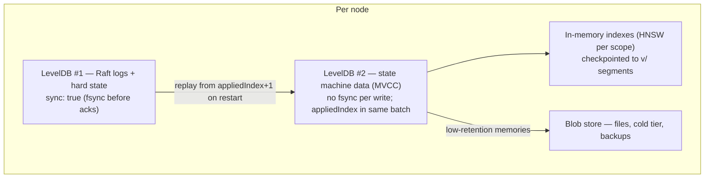
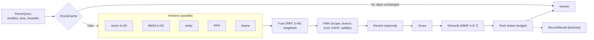

# Mindlog — System Design

This is the architecture of Mindlog as a whole system: what it is for, how it is deployed, how requests flow through it, how data is replicated and stored, how the AI memory engine works, and how it behaves when things fail. [`PLAN.md`](PLAN.md) holds the full specifications (section numbers are cited as "PLAN n"), and [`adr/`](adr) records why each major decision was made. Section 18 lists what exists in the code today.

**Contents**

1. [Requirements](#1-requirements)
2. [System context](#2-system-context)
3. [Deployment topology](#3-deployment-topology)
4. [Logical architecture](#4-logical-architecture)
5. [Data model and keyspace](#5-data-model-and-keyspace)
6. [Write path](#6-write-path)
7. [Read path and consistency](#7-read-path-and-consistency)
8. [Replication and cluster management](#8-replication-and-cluster-management)
9. [Storage engine](#9-storage-engine)
10. [Indexes](#10-indexes)
11. [Memory engine](#11-memory-engine)
12. [Log-native features](#12-log-native-features)
13. [Interfaces and errors](#13-interfaces-and-errors)
14. [Security and multi-tenancy](#14-security-and-multi-tenancy)
15. [Observability](#15-observability)
16. [Failure handling](#16-failure-handling)
17. [Scalability](#17-scalability)
18. [Testing strategy and implementation status](#18-testing-strategy-and-implementation-status)
19. [Key decisions and trade-offs](#19-key-decisions-and-trade-offs)

---

## 1. Requirements

### 1.1 Functional

| Capability | Summary | PLAN |
|---|---|---|
| Redis-compatible KV | Core Redis command set over RESP3; standard clients and `redis-cli` work unchanged | 1.3 G1, 15.1 |
| Durable replication | No acknowledged write is lost while a majority of a range's replicas is alive | G2, 7 |
| Agent memory over MCP | remember / recall / improve / forget with hybrid retrieval and a knowledge graph | G3, 12, 15.2 |
| Safe shared memory | Branches, commit-time conflict detection, point-in-time recall, provenance and quarantine | G4, 13 |
| Horizontal scale | Ranges split and rebalance as nodes are added | G5, 8 |
| Offline | Every model runs locally on CPU; no network dependency by default | G6, ADR-020 |
| Dashboard | Inspect and edit all data and memory | G7, 17 |
| Full-stack mode (optional) | Collections, auth, rules, files, realtime | G8, 16 |

### 1.2 Non-functional targets (verified in phase 11)

| Quality | Target (3 nodes on one laptop) |
|---|---|
| Write availability | Writes succeed with ≥ 2 of 3 replicas up |
| Failover | New leader serving writes < 3 s after a leader crash |
| KV latency | Write p99 < 15 ms; lease read p99 < 3 ms |
| Recall latency | p95 < 150 ms over 100k memories in scope (no rerank) |
| Memory write | p95 < 2 s with CPU extraction; < 20 ms acknowledgment in async mode |
| Durability | Zero acknowledged-write loss in Maelstrom and chaos runs |

### 1.3 Out of scope for v1

Full Redis Cluster protocol, Lua, RDB/AOF compatibility, SQL, multi-region geo-replication, model training, Byzantine faults.

---

## 2. System context



One system replaces a typical agent stack of Redis + vector DB + graph DB + app database + memory library. Every surface is a standard protocol (RESP3, MCP, REST/SSE, gRPC, OpenTelemetry, Prometheus), so nothing requires a bespoke client.

---

## 3. Deployment topology

### 3.1 Processes

| Process | Language | Count | Role |
|---|---|---|---|
| `mindlog-server` | TypeScript (Node.js LTS) | 3+ (one per node) | Protocol adapters, Raft, storage, indexes, memory engine, dashboard host |
| `mindlog-pd` | TypeScript | 3 (can share hosts with servers) | Placement driver: range directory, timestamp oracle, schedulers |
| `mindlog-models` | Python 3.12 | 1 sidecar per server | Embeddings, NER, NLI, reranking, fact extraction |
| Object store | MinIO / S3 / local disk | optional | Files, cold memory tier, backups |



**Single-node mode** runs one server with an embedded single-member PD and one sidecar (`docker compose --profile dev up`). The cluster profile adds 3 nodes, 3 PD members, MinIO, Prometheus, Grafana and Jaeger.

### 3.2 Ports

| Port | Protocol | Purpose |
|---|---|---|
| 6379 | RESP3 (TLS optional) | Redis clients |
| 8765 | MCP Streamable HTTP | Remote agents (stdio needs no port) |
| 8090 | HTTP | Dashboard `/_/`, REST `/api/`, SSE, `/metrics`, `/health`, `/ready` |
| 9090 | gRPC | Public API and SDKs |
| 7000 | gRPC + mTLS | Node-to-node Raft transport, snapshot streaming, request forwarding |
| 7100 | gRPC + mTLS | Placement driver |
| 50051 | gRPC (localhost) | Server → model sidecar |

These defaults come from `@mindlog/core`'s config schema and can be overridden by `mindlog.yaml`, `MINDLOG_*` environment variables or flags.

---

## 4. Logical architecture

### 4.1 Layers

Mindlog is a hexagonal (ports and adapters) system split into one package per module (ADR-0002). Imports point only downward. ESLint boundary rules, madge and TypeScript project references enforce this in CI, and an architecture test proves that the rules fire.



| Layer | Owns | Must not |
|---|---|---|
| Interfaces | Parsing, validation, serialisation per protocol | Hold business logic or touch storage |
| Application | Authorization, request routing, use-case facades | Know wire formats |
| Domain | Memory, KV, collection and transaction rules | Import infrastructure (LevelDB, gRPC, Fastify, `fs`, `net`) |
| Replication | Consensus, deterministic apply, ranges, placement | Call models or read the wall clock in apply |
| Storage/indexes | Persistence and search behind ports | Know about Raft or protocols |
| Core | Types, errors, ids, HLC, key encoding, config, telemetry | Depend on any other Mindlog package |

### 4.2 Ports and adapters

Each package declares the interfaces it needs (ports). Infrastructure implements them (adapters), and only `packages/server/src/bootstrap/` connects the two. Every port has a production adapter, an in-memory fake and a shared contract test suite that both must pass.

| Port | Declared by | Production adapter | Fake |
|---|---|---|---|
| `Clock`, `Random` | core | `SystemClock`, `SystemRandom` | `ManualClock`, `SeededRandom` |
| `Logger`, `Metrics`, `Tracer` | core | pino, Prometheus client, OpenTelemetry | `MemoryLogger`, `MemoryMetrics` |
| `EventBus` | eventbus | `InMemoryEventBus` | same |
| `KvStore`, `RaftLogStore` | storage, raft | classic-level (LevelDB) | in-memory sorted map |
| `RaftTransport` | raft | gRPC transport | simulated network |
| `Embedder`, `Extractor`, `EntityRecognizer`, `NliClassifier`, `Reranker`, `Summarizer` | memory (via models-client) | gRPC to the Python sidecar | deterministic stubs |
| `VectorIndex`, `KeywordIndex`, `GraphIndex` | memory | hnswlib-node, BM25, adjacency lists | brute-force versions |
| `Proposer` | memory, jobs, collections | multi-raft replica | direct-apply fake |

Extensible concepts (retrievers, pipeline stages, model providers, field types, schedulers, cache evaluators, blob stores, RESP commands) follow **one interface + a registry**. Recall configurations are named **recipes** (retrievers + fusion + reranker + packing), as in Graphiti.

### 4.3 The central rule: the log is the source of truth



`apply(command, index)` is a pure function of the committed log (ADR-0003). It does not read the clock (it uses `cmd.hlc`), use ambient randomness (seeds come from the index or ids), call the network, or call models. Lint bans these in `statemachine/**` and `*/apply/**`. Every write carries a `requestId` for idempotency. Environmental errors in apply crash the replica (fail-stop) rather than skipping an entry. Expiry, GC, leases and job leasing are themselves commands.

---

## 5. Data model and keyspace

### 5.1 Key encoding (implemented in `@mindlog/core`)

Every node has one ordered keyspace. Keys use the FoundationDB tuple-layer typecodes, so **byte order equals tuple order**; this is checked for 100,000 random tuples on every test run.

```
key := element(tenant) element(family) element(e1) … element(en) [ 0x40 ~commitIndex(8 bytes) ]

null 0x00 │ bytes 0x01 … 00 │ string 0x02 utf-8 … 00 │ integer 0x0c–0x1c (sign+length in code)
double 0x21 (IEEE sign-flip) │ false 0x26 │ true 0x27 │ version marker 0x40
```

- Elements are self-delimiting, so a tuple prefix is a byte prefix, and `[prefix, prefix + 0xff)` is the scan range for everything under it.
- `0x00` inside strings and bytes is escaped as `0x00 0xff`.
- The version suffix stores the bitwise-NOT of the commit index, so versions of a key are contiguous and the newest sorts first.
- The tenant always comes first, so tenant ranges never overlap (CLAUDE.md rule 10).

### 5.2 Key families

| Family | Tuple | Holds |
|---|---|---|
| `k` | (user key, …) | Redis values: strings, hashes (`'h'`, field), lists (`'l'`, seq), sets, sorted sets (`'z'` member → score and `'Z'` score, member), streams, JSON |
| `m` | (scope, branch, memoryId) | Memory records |
| `v` | (scope, segment) | Persisted HNSW segments |
| `t` | (scope, term, memoryId) | BM25 postings |
| `g` | (`out`\|`in`, scope, src, relation, dst) | Graph edges |
| `e` | (scope, entityId) | Entities |
| `c` / `x` / `u` | collection records / secondary indexes / unique constraints | Full-stack mode |
| `q` | (scope, promptHash) | Semantic cache entries |
| `j` | (queue, state, jobId) | Durable jobs (they live in the scope's range and move with it) |
| `s` | (subsystem, …) | System data: schemas, branches, conflicts, idempotency table, range descriptors, users, audit |

### 5.3 Memory record

A memory is an append-only record with **four timestamps**, following Graphiti:

| Field group | Fields |
|---|---|
| Identity | `id` (ULID), `scope` (tenant / user / agent / session), `branch`, `kind` (episodic, semantic, procedural, working, theme, tool_trace) |
| Content | `text`, `embedding {modelId, dims, vector}`, `entities`, `links` (related, supports, derived_from, supersedes, contradicts) |
| Provenance | `source {type, ref, principal}`, `trust` (verified / normal / quarantined) |
| Lifecycle | `importance`, `strength` (forgetting-curve S), `recallCount`, `lastRecalledAt`, `tier` (hot / cold), `version` |
| Time | `createdAt` (HLC of commit), `expiredAt` (system time it was superseded), `validFrom` / `validTo` (world time the fact held), `logIndex` |

Facts are never overwritten. A newer fact supersedes an older one by setting `validTo` / `expiredAt` from the command's HLC and writing a new version. Deletion is an explicit, audited command.

---

## 6. Write path

Example: an agent calls `remember` (MCP) or `MEM.ADD` (RESP) for scope `acme/alice`.



- **Fast acknowledgment**: with `async: true`, step 6 is skipped. The raw episode is committed immediately and an `enrich` job finishes the pipeline later, proposing a `MemoryEvolve`.
- **Degraded mode**: if the sidecar is down, extraction stages are skipped, raw episodic memory is stored, enrichment is queued, and the reply carries `degraded: true`.
- **Plain KV writes** (`SET`, `HSET`) follow the same path without step 6. `MULTI`/`EXEC` and multi-key writes within one range are a single command.
- **Batching**: proposals are batched per tick, and all ranges' log appends in one event-loop turn share one LevelDB batch and one fsync (group commit).

---

## 7. Read path and consistency

| Level | Guarantee | Mechanism | Default for |
|---|---|---|---|
| `linearizable` | Sees every write acknowledged before the read began | ReadIndex (leader confirms with a heartbeat round) | Admin, `WATCH`/`EXEC` |
| `lease` | Linearizable assuming bounded clock drift | Leader lease (< election timeout × (1 − drift)), requires CheckQuorum | Redis reads, collections |
| `bounded_staleness(δ)` | At most δ old | Follower read at its applied index if `now − appliedHlc ≤ δ` | Agent recall (δ = 500 ms) |
| `snapshot(t)` | Consistent view at a time or index | MVCC read at a version | `ASOF`, exports, backups |
| `session` | Read-your-writes, monotonic reads | Client carries last-seen index per range | SDKs, embedded replicas |



Recall reads several indexes. They are all updated inside the same apply, so a recall at index *i* sees one consistent version of records, vectors, postings and edges.

---

## 8. Replication and cluster management

### 8.1 Raft core

`@mindlog/raft` is a **pure state machine** modelled on etcd raft: inputs are `tick`, `step(msg)`, `propose`, `readIndex`; the output is a `Ready` batch. The host performs I/O in a fixed order, which is what makes Raft testable in a deterministic simulator.



Features: PreVote, CheckQuorum, pipelined AppendEntries with flow control (Probe / Replicate / Snapshot progress states), ReadIndex, leader leases, follower reads, chunked snapshots, learners, single-server membership changes (ADR-006), leadership transfer, proposal forwarding. Election timeouts come from the seeded `Random` port, not a global RNG.

| Timing | Default |
|---|---|
| Tick | 100 ms |
| Election timeout | random 10–20 ticks |
| Lease | 9 ticks |
| Max in-flight AppendEntries / follower | 256 |
| Snapshot threshold | 10,000 entries or 64 MiB |

Invariants are asserted in tests and debug builds: election safety, leader append-only, log matching, leader completeness, state machine safety, and `applied ≤ committed` with commit never decreasing.

### 8.2 Multi-Raft ranges

A **range** is a contiguous key span with its own Raft group (3 replicas by default), described by `{rangeId, startKey, endKey, epoch, replicas, placement}`.



- **One `Store` per node** drives all replicas: one Ready loop, one fsync per turn across ranges, and **coalesced heartbeats** per node pair (10,000 ranges ≠ 10,000 heartbeats).
- **Placement modes**: *key range* for Redis data and collections; *scope* for memory, where the key starts with (tenant, user) so one user's memory lives in one range and recall is single-range; *semantic split* for a scope that outgrows a range (k-means on embeddings, and recall fans out to the nearest 2 clusters).
- A stale range epoch in a request returns `RANGE_MOVED` with the new descriptor.

### 8.3 Placement driver (PD)

PD is its own 3-member Raft group. It owns the range directory, id allocation, a batched **timestamp oracle**, store heartbeats (capacity, load, model health) and **schedulers**: balance replicas and leaders, split hot ranges, merge cold ones, repair under-replication, and evacuate draining nodes. Scheduling decisions are **operators made of idempotent steps**, executed by range leaders. Each comes with an explanation plan that the dashboard shows (pattern from TiKV PD). PD is off the data path except for TSO, so the data path keeps running with a cached range map if PD loses quorum.

### 8.4 Routing

The router encodes the key or scope, finds the range in its cache, and sends the request to the cached leader. On `NOT_LEADER{hint}` it retries the hinted leader. On `RANGE_MOVED` it refreshes from PD. Retries use exponential backoff with jitter under the request deadline. Multi-key commands are split by range, run in parallel, and merged back in input order.

### 8.5 Time

Every node runs a **hybrid logical clock** (48-bit ms + 16-bit counter in one `uint64`). Every RPC carries the sender's HLC, and every command carries the proposer's. HLC gives the cluster a causally consistent time for `ASOF`, TTL, validity windows and audit. A node whose clock is more than 500 ms ahead of a peer gets `CLOCK_OFFSET_EXCEEDED`, refuses leases and alerts. Correctness is preserved because leases are simply turned off.

### 8.6 Transactions

- **Single range**: `MULTI`/`EXEC` and `WATCH` become one command; watched versions are preconditions checked in apply.
- **Cross range**: Percolator-style 2PC with TSO timestamps. The primary lock is the commit point, secondaries commit asynchronously, and readers resolve abandoned locks. It is used first for unique indexes in collections, behind a feature flag.

---

## 9. Storage engine



- **Two LevelDB instances** (classic-level, behind the `KvStore` port; ADR-005). The log instance fsyncs. The state instance can skip fsync because it can be rebuilt from the log: `appliedIndex` is written in the same batch, and a restart re-applies from `appliedIndex + 1`. Therefore **the log is never compacted past an index until the state store has been flushed with `sync` at or beyond it** (CLAUDE.md rule 7).
- **MVCC**: the version is the commit index, stored inverted after the `0x40` marker. A read at version V seeks to `key@~V`. Deletes write tombstones. GC is a replicated `GcThreshold` command (7 days for KV, 30 for memory by default), and branch fork points pin their versions.
- **Snapshots** are LevelDB snapshots of a range's span, streamed in 1 MiB chunks. The receiver stages them and swaps atomically, then rebuilds in-memory indexes from segments plus newer records.
- **Tiering**: memories whose forgetting-curve retention drops below a threshold move to the blob store as compressed segments. A stub with the summary and entity links stays hot, so graph walks still work.
- **Backups**: consistent per-range snapshots at a TSO timestamp plus incremental log segments, which allows point-in-time restore. Backups are verified by scheduled restores.
- **Encryption at rest** (phase 10): per-tenant AES-256-GCM data keys wrapped by a master key. Values are encrypted; keys stay plaintext so they remain ordered (ADR-014).

---

## 10. Indexes

All indexes are updated inside apply, so they never disagree with committed data, and each can be rebuilt from records by a durable job.

| Index | Structure | Details |
|---|---|---|
| Vector | HNSW per (scope, main) via hnswlib-node | M 16, efConstruction 200, efSearch 64, cosine, 384-d. Filters are pushed into search where the binding allows, otherwise over-fetch ×4. Rebuilt in a worker when > 20% deleted. Replicas may build slightly different graphs over identical records (ADR-008) |
| Keyword | BM25 postings `t/(scope, term, id)` | `Intl.Segmenter` tokenizer, stop words, light stemming; k1 = 1.2, b = 0.75; per-scope N, avgdl and df updated in apply |
| Graph | Edges in both directions (`g/out`, `g/in`) | Entity resolution: exact name → alias → embedding ≥ 0.88. Personalized PageRank over entity + memory nodes (HippoRAG settings: damping 0.5, entity seeds normalised by mention count, memory seeds × 0.05), in a worker with a 5,000-node cap |
| Secondary / unique | `x/(index, value, pk)`, `u/(collection, field, value)` | Unique checks happen in the same command (one range) or via 2PC |

---

## 11. Memory engine

The memory engine is a set of small components behind ports. It knows nothing about RESP, MCP or HTTP, nor which model runs behind a port. `MemoryService` is a thin facade (validate, authorize, choose sync or async). Work happens in **declarative pipelines** of stages, each in its own file, built from per-tenant configuration (pattern from Cognee). The engine writes only through the `Proposer`.

### 11.1 Ingestion (`remember`)


- Stages declare `needsModel`, `optional`, `timeoutMs` and `batchSize`, and return `Result<O, StageError>`. A **retryable** error is retried, a **skippable** one falls back to the stage's declared output, and a **fatal** one aborts.
- All outputs (facts, vectors, entities, links, conflicts) go into **one `MemoryCommit` command**, so followers never re-run models.
- Long work runs as **durable jobs** (`queued → leased → done | failed → dead`). Jobs live in the scope's range, leases are replicated commands held by the range leader with an epoch that fences stale workers, there are at most 5 retries, then the dead-letter queue, and queue depth limits return `BUSY`.

### 11.2 Recall



Final score (per-tenant weights, tuned on evals):

```
score = 0.60 · relevance(fused or reranked)
      + 0.15 · recency      (0.995 ^ hours since last access)        — Generative Agents
      + 0.15 · importance
      + 0.10 · retention    (e^(−t/S), S grows with spaced recall)   — MemoryBank
      − trust penalty       (quarantined excluded unless requested)
```

An optional `Explain` stage returns the score from each signal, which the dashboard's Recall Playground shows.

### 11.3 Consolidation

Leader-only background workers run per scope under per-tenant model-time budgets. All of them write through normal commands, are idempotent per `(worker, scope, inputVersion)`, and are checkpointed so a leader change resumes them.

| Worker | Trigger | Output |
|---|---|---|
| SleepTimeConsolidator | Scope idle ≥ 10 min after ≥ 20 new memories | Distils sessions on a `sleep/<ts>` **branch**, merged through the normal conflict-checked path |
| EvolutionWorker (A-MEM) | New memory linked to older ones | New versions of neighbours (never overwrites) |
| Deduplicator | Nightly | `supersedes` links, lower weight, never deletes |
| ThemeBuilder | Graph changed > 5% | `theme` memories from community detection |
| ForgettingWorker | Hourly | Tier changes by retention |
| ReembedWorker | Embedding model changed | New index generation, switched atomically by command |

---

## 12. Log-native features

These follow directly from the replicated log. Prior art exists for each one on its own; Mindlog's contribution is doing them **inside a replicated multi-agent database with decisions made at commit time**.

| Feature | Design |
|---|---|
| **Branches** | Metadata `{forkIndex, forkHlc, parent, status}`. Branch writes use `branch = name`; reads overlay branch keys on `main@forkIndex`. A merge runs on the leader: CRDT rules for structured fields (OR-set, PN-counter, LWW by HLC) and NLI conflict checks for text facts, with policy `abort / raise / prefer_branch / prefer_main` |
| **Conflict detection** | For each new fact, compare against the top-5 similar facts and facts sharing entities. Run NLI both ways. `p_contradict ≥ 0.80` → conflict record + new fact quarantined (default policy). `p_entail ≥ 0.90` → duplicate. Non-overlapping validity windows are history, not conflict. Resolution sets `validTo`, never deletes |
| **Point-in-time recall** | `ASOF index` is an MVCC read. `ASOF time` maps HLC → index through a per-second index-time table. Vector search over-fetches and then filters to records that existed at that version. `VALID_AT` filters on world time independently |
| **Provenance and quarantine** | Every record has `source` and `principal`, and derived records have `derived_from`. Untrusted sources are quarantined and passed to models only as quoted data. `FORGET SOURCE` cascades through derivations |
| **Change streams** | Every applied command yields `{rangeId, index, hlc, principal, keys, op}`. Subscribers (SSE, MCP, SDK, cache invalidator) resume from `(rangeId, index)`. A subscriber that fell behind compaction gets `ResyncRequired` |
| **Semantic cache** | Two-stage lookup (ANN, then a pluggable evaluator), with an L1 exact-hash cache and an L2 replicated cache. Entries record the memories they depend on, and the change stream invalidates them when those memories change |
| **Token-budget packing** | Greedy by score per token with an MMR penalty and one improvement pass; per-group caps (facts, episodes, themes, procedures) |
| **Embedded replicas** | The SDK keeps a local LevelDB of subscribed scopes: a snapshot plus the change stream, session consistency, and an offline write queue with request ids |

---

## 13. Interfaces and errors

| Interface | Shape | Notes |
|---|---|---|
| RESP3 | Redis commands plus `MEM.*`, `CACHE.*`, `IDX.*` | Command table generated from Valkey-shaped JSON specs (arity, flags, key specs, ACL categories). `HELLO` negotiation, RESP2 downgrade, push frames for invalidation |
| MCP | Tools: remember, recall, improve, forget, branch, resolve, cache_store … | `@modelcontextprotocol/server` over Streamable HTTP (:8765) and stdio. Zod v4 schemas shared with REST. Structured content plus a short text summary, with size-bounded outputs |
| REST + SSE | `/api/…`, `/api/realtime` | Fastify. OpenAPI generated from the same Zod schemas. RFC 9457 problem details |
| gRPC | Public services + SDKs | Protobuf in `proto/`, checked by buf lint and breaking-change detection |
| Dashboard | React + shadcn/ui static app at `/_/` (ADR-0023) | Uses only the public API, with the same authorization and audit as any client. No CDN calls |

Adapters are thin: parse → validate → call an application service → serialise. **Errors come from one table** in `@mindlog/core` (implemented). Each `MindlogErrorCode` maps to exactly one reply per interface, so adapters never invent errors:

| Code (examples) | RESP | HTTP | gRPC | Retryable |
|---|---|---|---|---|
| `INVALID_ARGUMENT` | `-ERR` | 400 | INVALID_ARGUMENT | no |
| `WRONG_TYPE` | `-WRONGTYPE` | 409 | FAILED_PRECONDITION | no |
| `BUSY` | `-BUSY` | 503 | RESOURCE_EXHAUSTED | yes |
| `NOT_LEADER` | `-TRYAGAIN` | 503 | UNAVAILABLE | yes |
| `RANGE_MOVED` | `-MOVED` | 421 | UNAVAILABLE | yes |
| `CLOCK_OFFSET_EXCEEDED` | `-TRYAGAIN` | 503 | UNAVAILABLE | yes |

Public error details never carry internal causes; those go to logs only.

---

## 14. Security and multi-tenancy

- **Tenant isolation by construction**: no API reaches storage without a resolved tenant, and the tenant is the first element of every key.
- **Authorization in the application layer** for every request (RESP, MCP, REST, gRPC, dashboard): roles × actions × ownership × tenant, tested as a matrix. Agents never hold admin roles, and delegated tokens record both principal and actor.
- **Transport**: TLS for client protocols, mTLS between nodes and to PD. The `production` profile forces TLS, auth and mTLS.
- **Untrusted content**: quarantined, and passed to models only as quoted data with a fixed instruction (prompt-injection defense).
- **Secrets**: never in logs, errors, traces or fixtures. The logger redacts secret fields (implemented).
- **Audit**: data-affecting decisions (conflict, quarantine, eviction, merge rejection, scheduling) write audit or explain records.
- **Supply chain**: lockfiles, `pnpm audit` and `pip-audit`, pinned CI actions.

---

## 15. Observability

| Signal | Design |
|---|---|
| Metrics | Prometheus at `/metrics`. Names follow `mindlog_<area>_<thing>_<unit>`, which the registry enforces at registration (implemented). Every request path and worker gets a latency histogram and an error counter. `event_loop_lag` is mandatory |
| Traces | OpenTelemetry spans from adapter → router → leader → propose → apply → model call. W3C context is propagated to the Python sidecar. Parent-based ratio sampling. Off unless an OTLP endpoint is configured (implemented) |
| Logs | JSON lines (pino) with `traceId`, `tenant` and `rangeId` bindings, secrets redacted, and bigints logged exactly as strings (implemented) |
| Health | `/health` (process alive); `/ready` (storage open, ranges caught up, PD reachable; a degraded model service is allowed) |
| Alerts | Leader churn, follower lag > 10k entries, event-loop lag p99 > 100 ms, disk > 85%, model service down > 5 min, dead-letter jobs > 0, clock offset > 250 ms |

---

## 16. Failure handling

| Failure | Detected by | Behaviour |
|---|---|---|
| Follower crash | Missed heartbeats | Writes continue on the majority; PD re-replicates after 5 min |
| Leader crash | Election timeout | New leader in 1–3 s; router retries; lease reads pause until a new lease |
| Partition | CheckQuorum, PreVote | The minority stops serving writes and linearizable reads; bounded-staleness reads may continue |
| Slow follower | Lag metric | Leader throttles in-flight messages; sends a snapshot if the follower is behind the compacted log |
| Disk full / corruption | Write error / CRC32C mismatch | Fail-stop the affected ranges; corrupt replicas drop local data and re-fetch a snapshot |
| Clock skew | HLC offset check | Node refuses leases and alerts; correctness preserved |
| PD quorum loss | RPC failures | Data path continues on the cached range map; splits, moves and TSO pause |
| Model sidecar down or hung | Health checks, deadlines, circuit breaker | **Degraded mode**: raw episodic storage, queued enrichment, recall with the retrievers that still work (BM25 only if the embedder is down), `degraded: true` |
| Bad command (bug) | Apply exception | Deterministic validation errors are stored as the result; unexpected exceptions fail-stop the replica, and an entry is never skipped |
| Runaway tenant | Quotas | `BUSY` / quota errors for that tenant only; background work is shed first |

Every new failure path gets a simulator scenario.

---

## 17. Scalability

- **Horizontal**: data scales by ranges. Adding a node triggers rebalancing, and memory scales by scope placement and semantic splits.
- **Range-local hot paths**: a user's memory lives in one range, so recall touches one range. Cross-range work goes through the router or 2PC, and there are no cross-range scans on request paths.
- **Batching at every boundary**: proposals per tick, one fsync per Ready cycle across ranges, coalesced heartbeats, micro-batched model calls (≤ 5 ms or 32 items), and chunked fan-out for the change stream.
- **Keep the event loop free**: CPU work over ~1 ms (large vector searches, PPR, BM25 over many candidates, packing, snapshot encoding) runs in a bounded `worker_threads` pool (Piscina).
- **Backpressure everywhere**: bounded proposal queues (`BUSY`), per-connection output limits, job-queue depth limits, per-tenant quotas. Cursors and pagination everywhere; no unbounded scans.
- **Quiescence**: idle ranges stop ticking.
- **Memory caps**: indexes respect the node RSS budget, and eviction uses retention scores rather than LRU.
- **Reads scale out** through follower and bounded-staleness reads, and through SDK embedded replicas.

---

## 18. Testing strategy and implementation status

### 18.1 Test pyramid

| Level | Tooling | Gate |
|---|---|---|
| Unit + property | Vitest, fast-check | Every PR; ≥ 85% line coverage on domain packages |
| Contract | Shared suites per port; buf breaking; TS ↔ Python golden bytes | Every PR |
| Architecture | Lint fixtures proving boundary and determinism rules fire | Every PR |
| Deterministic simulation | Whole cluster in one process with simulated network, disk, clock and RNG; fault schedules; invariants | 1,000 seeds per PR, 100,000 nightly; failing seeds become regression tests |
| Linearizability | Jepsen Maelstrom `lin-kv`, `txn-list-append` | Nightly from phase 3 |
| Compatibility, fuzzing, chaos, load | Redis client suites, parser fuzzers, Docker + `tc`/iptables, redis-benchmark/memtier | Nightly / weekly / per release |
| AI evaluation | LongMemEval, LoCoMo, ablations, conflict F1, cache hit/false-hit | Per change to the memory engine |

### 18.2 What exists today (phase 2)

| Area | Status |
|---|---|
| Tooling | pnpm workspace (TypeScript 6, strict), ESLint with layer boundaries, madge, Prettier, Vitest + fast-check, changesets, commitlint, uv workspace (ruff, mypy --strict, pytest), buf |
| `@mindlog/core` | Result, error table, Clock/Random ports (+ fakes), ULID, HLC, order-preserving key encoding and decoder, layered config (with `limits` and `auth`), logger, metrics (with process and event-loop series), tracing, ScopePath, CRC-32C |
| `@mindlog/eventbus` | Typed domain events, EventBus port, in-memory bus |
| `@mindlog/proto` / `mindlog-proto` | `Command` envelope with `KvWrite`, `KvBatch`, `Expire`, `GcThreshold` bodies, `CommandResult`, `KvReply`; generated TS and Python; golden-byte tests |
| `@mindlog/storage` | `KvStore` port, `LevelDbStore` and `MemoryStore` (one contract suite), MVCC versions, tombstones, scans at a version, version GC |
| `@mindlog/statemachine` | `Proposer` port, `StateMachine` with an apply-handler registry, idempotency table, `appliedIndex`, `LocalLog` (CRC-32C, fsync, truncation record), `LocalProposer` (group commit, BUSY, `storage.write` and `statemachine.apply` spans), recovery replay |
| `@mindlog/kv` | 100 Redis commands over generations (strings, keys, expiry, hashes, lists, sets, sorted sets, JSON subset), SCAN cursors, replicated expiry and GC jobs |
| `@mindlog/services` | `KvService`: sessions, static AUTH, reads on applied state, writes through the Proposer, MULTI/EXEC/WATCH, spans and metrics. `KvBrowser`: typed key reads and atomic replace for REST. `AdminService`: superusers in `$system`, scrypt, HMAC bearer tokens (ADR-0024) |
| `@mindlog/adapter-resp` | RESP2/RESP3 parser and writer, JSON command specs, `COMMAND`/`DOCS`, HELLO/CLIENT/INFO/CONFIG GET, pipelining, limits, TCP server, `resp.command` spans, preauthenticated connections for the console |
| `@mindlog/adapter-http` | Fastify: `/health`, `/ready`, `/metrics`, `/api/kv/*`, superuser login, admin overview and settings, OpenAPI from Zod, RFC 9457 errors, RESP console over WebSocket, dashboard at `/_/` |
| `web/` | React + shadcn/ui dashboard (ADR-0023): login, overview, data browser with typed editors, console, settings |
| `@mindlog/server` | Composition root, `mindlog-server --single-node` (RESP + HTTP), `superuser upsert`, graceful shutdown |
| Python | `model_service` placeholder process; redis-py compatibility suite |
| Deploy | `Dockerfile`s, `docker-compose.yml` (`dev`: node, model service, Prometheus, Grafana, Jaeger), Grafana dashboard in `deploy/grafana/` |
| CI | Lint, typecheck, tests (TS, web, Python), protobuf drift and breaking checks, Conventional Commits, gate job (redis-py, kill -9 durability, redis-benchmark) |
| Gates | Phase 0, 1 and 2 (`docs/phases/phase-N.md`) |

Everything else in this document is designed but not built yet; it arrives phase by phase (PLAN 24).

---

## 19. Key decisions and trade-offs

| Decision | Why | Cost | Record |
|---|---|---|---|
| TypeScript server + Python model sidecar | MCP and dashboard ecosystem in TS; local-model ecosystem in Python | Two toolchains; CPU work must leave the event loop | ADR-0001 |
| Hexagonal, package-per-module, enforced boundaries | Testability, deterministic simulation, no god objects | Per-package setup overhead | ADR-0002 |
| Raft log as the single source of truth; deterministic apply | Branching, time travel, change streams and catch-up all follow from it | Larger commands (embedded model outputs) | ADR-0003 |
| Protobuf for commands and internal RPCs | Schema evolution checks across TS and Python | Codegen step (committed, drift-checked) | ADR-0004 |
| FDB tuple encoding with variable-length integers | Compact, proven order-preserving keys | Strict decoder needed to keep one encoding per key | PLAN 5.1 |
| Two LevelDB instances, state without fsync | Log fsyncs don't contend with compaction | Strict compaction-after-flush rule | ADR-005 |
| Models only on the leader, outputs in the command | Replicas never diverge from model nondeterminism | Leader does all inference | ADR-016 |
| HNSW graphs may differ across replicas | Use the stock binding in v1 | Tiny recall differences between replicas | ADR-008 |
| Offline-first, tracing off by default | Runs with no network | Operators must opt in to export | ADR-020 |
| Dashboard in React + shadcn/ui, served at `/_/` | Rich component ecosystem for later pages | Larger bundle than SvelteKit | ADR-0023 |
| Superusers as argv-written hashes in `$system`, HMAC bearer tokens | No new command type or format; no CSRF surface | Login rate limiting and MFA come later | ADR-0024 |

ADRs 0005 and later are written in the phase that needs them (PLAN 25).
