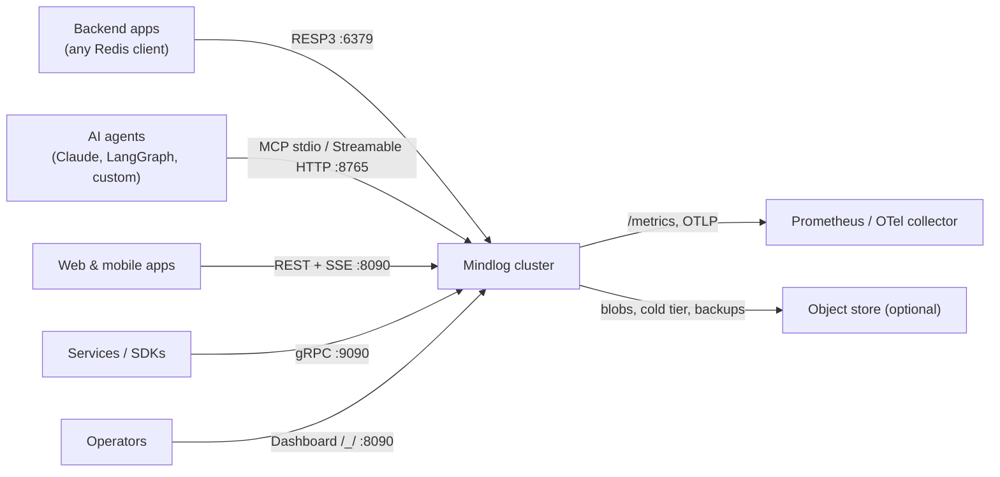
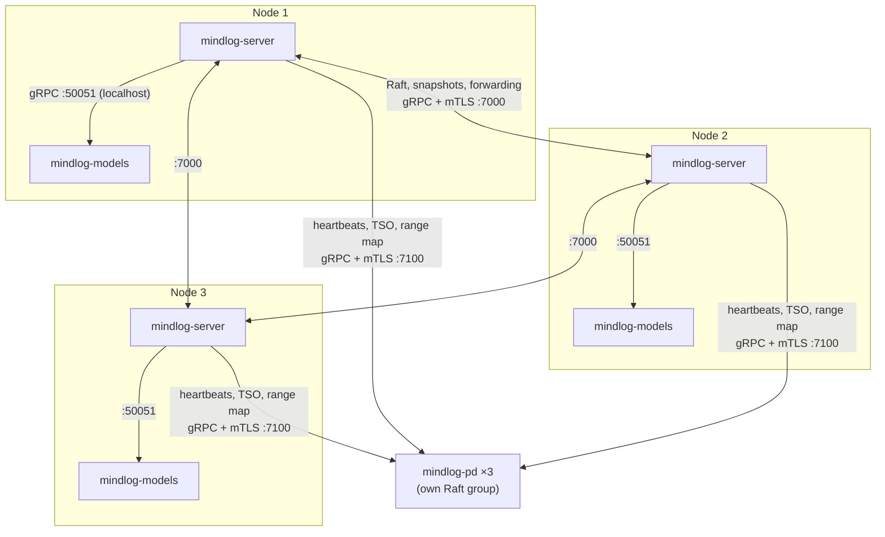
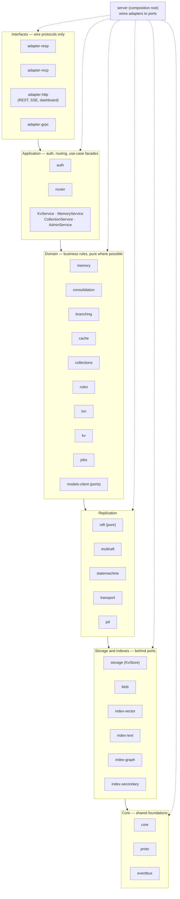
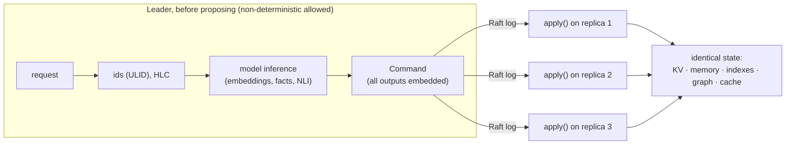

# Mindlog — System Design

This is the architecture of Mindlog as a whole system: what it is for, how it is deployed, how requests flow through it, how data is replicated and stored, how the AI memory engine works, and how it behaves when things fail. [`PLAN.md`](PLAN.md) holds the full specifications (section numbers are cited as "PLAN n"), and [`adr/`](adr) records why each major decision was made. Section 18 lists what exists in the code today.

**Contents**

1. [Requirements](#1-requirements)
2. [System context](#2-system-context)
3. [Deployment topology](#3-deployment-topology)
4. [Logical architecture](#4-logical-architecture)
5. [Data model and keyspace](#5-data-model-and-keyspace)
6. [Write path](#6-write-path)
7. [Read path and consistency](#7-read-path-and-consistency)
8. [Replication and cluster management](#8-replication-and-cluster-management)
9. [Storage engine](#9-storage-engine)
10. [Indexes](#10-indexes)
11. [Memory engine](#11-memory-engine)
12. [Log-native features](#12-log-native-features)
13. [Interfaces and errors](#13-interfaces-and-errors)
14. [Security and multi-tenancy](#14-security-and-multi-tenancy)
15. [Observability](#15-observability)
16. [Failure handling](#16-failure-handling)
17. [Scalability](#17-scalability)
18. [Testing strategy and implementation status](#18-testing-strategy-and-implementation-status)
19. [Key decisions and trade-offs](#19-key-decisions-and-trade-offs)

---

## 1. Requirements

### 1.1 Functional

| Capability | Summary | PLAN |
|---|---|---|
| Redis-compatible KV | Core Redis command set over RESP3; standard clients and `redis-cli` work unchanged | 1.3 G1, 15.1 |
| Durable replication | No acknowledged write is lost while a majority of a range's replicas is alive | G2, 7 |
| Agent memory over MCP | remember / recall / improve / forget with hybrid retrieval and a knowledge graph | G3, 12, 15.2 |
| Safe shared memory | Branches, commit-time conflict detection, point-in-time recall, provenance and quarantine | G4, 13 |
| Horizontal scale | Ranges split and rebalance as nodes are added | G5, 8 |
| Offline | Every model runs locally on CPU; no network dependency by default | G6, ADR-020 |
| Dashboard | Inspect and edit all data and memory | G7, 17 |
| Full-stack mode (optional) | Collections, auth, rules, files, realtime | G8, 16 |

### 1.2 Non-functional targets (verified in phase 11)

| Quality | Target (3 nodes on one laptop) |
|---|---|
| Write availability | Writes succeed with ≥ 2 of 3 replicas up |
| Failover | New leader serving writes < 3 s after a leader crash |
| KV latency | Write p99 < 15 ms; lease read p99 < 3 ms |
| Recall latency | p95 < 150 ms over 100k memories in scope (no rerank) |
| Memory write | p95 < 2 s with CPU extraction; < 20 ms acknowledgment in async mode |
| Durability | Zero acknowledged-write loss in Maelstrom and chaos runs |

### 1.3 Out of scope for v1

Full Redis Cluster protocol, Lua, RDB/AOF compatibility, SQL, multi-region geo-replication, model training, Byzantine faults.

---

## 2. System context



One system replaces a typical agent stack of Redis + vector DB + graph DB + app database + memory library. Every surface is a standard protocol (RESP3, MCP, REST/SSE, gRPC, OpenTelemetry, Prometheus), so nothing requires a bespoke client.

---

## 3. Deployment topology

### 3.1 Processes

| Process | Language | Count | Role |
|---|---|---|---|
| `mindlog-server` | TypeScript (Node.js LTS) | 3+ (one per node) | Protocol adapters, Raft, storage, indexes, memory engine, dashboard host |
| `mindlog-pd` | TypeScript | 3 (can share hosts with servers) | Placement driver: range directory, timestamp oracle, schedulers |
| `mindlog-models` | Python 3.12 | 1 sidecar per server | Embeddings, NER, NLI, reranking, fact extraction |
| Object store | MinIO / S3 / local disk | optional | Files, cold memory tier, backups |



**Single-node mode** runs one server with an embedded single-member PD and one sidecar (`docker compose --profile dev up`). The cluster profile adds 3 nodes, 3 PD members, MinIO, Prometheus, Grafana and Jaeger.

### 3.2 Ports

| Port | Protocol | Purpose |
|---|---|---|
| 6379 | RESP3 (TLS optional) | Redis clients |
| 8765 | MCP Streamable HTTP | Remote agents (stdio needs no port) |
| 8090 | HTTP | Dashboard `/_/`, REST `/api/`, SSE, `/metrics`, `/health`, `/ready` |
| 9090 | gRPC | Public API and SDKs |
| 7000 | gRPC + mTLS | Node-to-node Raft transport, snapshot streaming, request forwarding |
| 7100 | gRPC + mTLS | Placement driver |
| 50051 | gRPC (localhost) | Server → model sidecar |

These defaults come from `@mindlog/core`'s config schema and can be overridden by `mindlog.yaml`, `MINDLOG_*` environment variables or flags.

---

## 4. Logical architecture

### 4.1 Layers

Mindlog is a hexagonal (ports and adapters) system split into one package per module (ADR-0002). Imports point only downward. ESLint boundary rules, madge and TypeScript project references enforce this in CI, and an architecture test proves that the rules fire.



| Layer | Owns | Must not |
|---|---|---|
| Interfaces | Parsing, validation, serialisation per protocol | Hold business logic or touch storage |
| Application | Authorization, request routing, use-case facades | Know wire formats |
| Domain | Memory, KV, collection and transaction rules | Import infrastructure (LevelDB, gRPC, Fastify, `fs`, `net`) |
| Replication | Consensus, deterministic apply, ranges, placement | Call models or read the wall clock in apply |
| Storage/indexes | Persistence and search behind ports | Know about Raft or protocols |
| Core | Types, errors, ids, HLC, key encoding, config, telemetry | Depend on any other Mindlog package |

### 4.2 Ports and adapters

Each package declares the interfaces it needs (ports). Infrastructure implements them (adapters), and only `packages/server/src/bootstrap/` connects the two. Every port has a production adapter, an in-memory fake and a shared contract test suite that both must pass.

| Port | Declared by | Production adapter | Fake |
|---|---|---|---|
| `Clock`, `Random` | core | `SystemClock`, `SystemRandom` | `ManualClock`, `SeededRandom` |
| `Logger`, `Metrics`, `Tracer` | core | pino, Prometheus client, OpenTelemetry | `MemoryLogger`, `MemoryMetrics` |
| `EventBus` | eventbus | `InMemoryEventBus` | same |
| `KvStore`, `RaftLogStore` | storage, raft | classic-level (LevelDB) | in-memory sorted map |
| `RaftTransport` | raft | gRPC transport | simulated network |
| `Embedder`, `Extractor`, `EntityRecognizer`, `NliClassifier`, `Reranker`, `Summarizer` | memory (via models-client) | gRPC to the Python sidecar | deterministic stubs |
| `VectorIndex`, `KeywordIndex`, `GraphIndex` | memory | hnswlib-node, BM25, adjacency lists | brute-force versions |
| `Proposer` | memory, jobs, collections | multi-raft replica | direct-apply fake |

Extensible concepts (retrievers, pipeline stages, model providers, field types, schedulers, cache evaluators, blob stores, RESP commands) follow **one interface + a registry**. Recall configurations are named **recipes** (retrievers + fusion + reranker + packing), as in Graphiti.

### 4.3 The central rule: the log is the source of truth



`apply(command, index)` is a pure function of the committed log (ADR-0003). It does not read the clock (it uses `cmd.hlc`), use ambient randomness (seeds come from the index or ids), call the network, or call models. Lint bans these in `statemachine/**` and `*/apply/**`. Every write carries a `requestId` for idempotency. Environmental errors in apply crash the replica (fail-stop) rather than skipping an entry. Expiry, GC, leases and job leasing are themselves commands.

---

## 5. Data model and keyspace

### 5.1 Key encoding (implemented in `@mindlog/core`)

Every node has one ordered keyspace. Keys use the FoundationDB tuple-layer typecodes, so **byte order equals tuple order**; this is checked for 100,000 random tuples on every test run.

```
key := element(tenant) element(family) element(e1) … element(en) [ 0x40 ~commitIndex(8 bytes) ]

null 0x00 │ bytes 0x01 … 00 │ string 0x02 utf-8 … 00 │ integer 0x0c–0x1c (sign+length in code)
double 0x21 (IEEE sign-flip) │ false 0x26 │ true 0x27 │ version marker 0x40
```

- Elements are self-delimiting, so a tuple prefix is a byte prefix, and `[prefix, prefix + 0xff)` is the scan range for everything under it.
- `0x00` inside strings and bytes is escaped as `0x00 0xff`.
- The version suffix stores the bitwise-NOT of the commit index, so versions of a key are contiguous and the newest sorts first.
- The tenant always comes first, so tenant ranges never overlap (CLAUDE.md rule 10).

### 5.2 Key families

| Family | Tuple | Holds |
|---|---|---|
| `k` | (user key, …) | Redis values: strings, hashes (`'h'`, field), lists (`'l'`, seq), sets, sorted sets (`'z'` member → score and `'Z'` score, member), streams, JSON |
| `m` | (scope, branch, memoryId) | Memory records |
| `v` | (scope, segment) | Persisted HNSW segments |
| `t` | (scope, term, memoryId) | BM25 postings |
| `g` | (`out`\|`in`, scope, src, relation, dst) | Graph edges |
| `e` | (scope, entityId) | Entities |
| `c` / `x` / `u` | collection records / secondary indexes / unique constraints | Full-stack mode |
| `q` | (scope, promptHash) | Semantic cache entries |
| `j` | (queue, state, jobId) | Durable jobs (they live in the scope's range and move with it) |
| `s` | (subsystem, …) | System data: schemas, branches, conflicts, idempotency table, range descriptors, users, audit |

### 5.3 Memory record

A memory is an append-only record with **four timestamps**, following Graphiti:

| Field group | Fields |
|---|---|
| Identity | `id` (ULID), `scope` (tenant / user / agent / session), `branch`, `kind` (episodic, semantic, procedural, working, theme, tool_trace) |
| Content | `text`, `embedding {modelId, dims, vector}`, `entities`, `links` (related, supports, derived_from, supersedes, contradicts) |
| Provenance | `source {type, ref, principal}`, `trust` (verified / normal / quarantined) |
| Lifecycle | `importance`, `strength` (forgetting-curve S), `recallCount`, `lastRecalledAt`, `tier` (hot / cold), `version` |
| Time | `createdAt` (HLC of commit), `expiredAt` (system time it was superseded), `validFrom` / `validTo` (world time the fact held), `logIndex` |

Facts are never overwritten. A newer fact supersedes an older one by setting `validTo` / `expiredAt` from the command's HLC and writing a new version. Deletion is an explicit, audited command.
