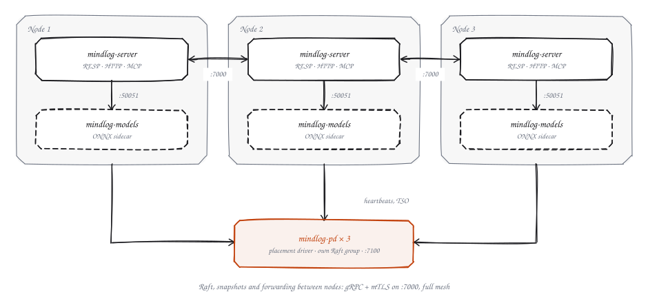
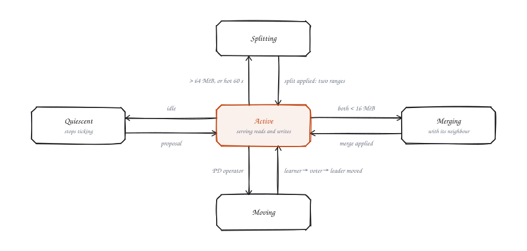

# Deploy with Docker and clusters

<figure><figcaption><p>A three-node deployment.</p></figcaption></figure>

## Topologies

| Topology | How | When |
|---|---|---|
| One node | `mindlog-server --single-node` | Development, a laptop agent, small apps. It is a one-voter Raft group with its own embedded placement driver |
| Three nodes + PD | `cluster.peers` and `pd.enabled` on each node | Production: survives the loss of any one node |
| Add nodes later | `cluster.join: true` plus `pdEndpoints` | Scale out. The placement driver moves replicas onto the new node |

Each node also runs a **model service** sidecar on `localhost:50051`, so model calls never cross the network.

## Compose profiles

| Profile | Services | RESP ports | HTTP ports |
|---|---|---|---|
| `dev` | 1 node, model service, Prometheus, Grafana, Jaeger | 6379 | 8090 |
| `cluster` | 3 nodes that also form the placement driver | 6391–6393 | 8101–8103 |
| `cluster-join` | Adds node 4 to `cluster` | 6394 | 8104 |
| `chaos` | 3 nodes with static Raft membership, for `scripts/chaos/*.sh` | 6381–6383 | 8091–8093 |
| `offline` | Node, model service and a demo agent on a network with no route out | — | — |

```bash
docker compose --profile cluster up --build -d
redis-cli -p 6391 CLUSTER.INFO
docker compose --profile cluster-join up -d        # node 4 joins; PD rebalances onto it
docker compose --profile cluster --profile cluster-join down -v
```

## Configure a three-node cluster

Each node gets the same file and a different `node.raftId` / `node.id` (here set through environment variables, `MINDLOG_NODE__RAFT_ID` and `MINDLOG_NODE__ID`):


```yaml
node:
  dataDir: /data
cluster:
  peers:
    - { id: 1, address: 'node-1:7000' }
    - { id: 2, address: 'node-2:7000' }
    - { id: 3, address: 'node-3:7000' }
  pdEndpoints: ['node-1:7100', 'node-2:7100', 'node-3:7100']
pd:
  enabled: true                 # this process also runs a PD replica
  peers:
    - { id: 1, address: 'node-1:7100' }
    - { id: 2, address: 'node-2:7100' }
    - { id: 3, address: 'node-3:7100' }
models:
  endpoint: 127.0.0.1:50051     # the node's own sidecar
```


```bash
mindlog-server -c mindlog.yaml
```

A node that joins later starts empty and waits to be given replicas:

```yaml
cluster:
  join: true
  advertise: 'node-4:7000'
  pdEndpoints: ['node-1:7100', 'node-2:7100', 'node-3:7100']
```

## What the cluster does by itself

* **Splits** a range above `ranges.maxBytes` (64 MiB) or when it stays above `ranges.splitQps` (2,500) for 60 s, and **merges** neighbours that are both below 16 MiB. A user's memory always stays in one range.
* **Repairs** under-replicated ranges after a node has been missing for `pd.deadAfterMs` (5 minutes).
* **Balances** replicas and leaders across nodes and zones (`node.zone`).
* **Quiesces** idle ranges, which stop ticking.

Every scheduling decision is recorded with an explanation, visible on the dashboard **Cluster** page and at `GET /api/cluster/overview`.

<figure><figcaption><p>The states of a range.</p></figcaption></figure>

## Operator actions

Actions are `POST /api/cluster/actions` (superuser) or buttons on the dashboard **Cluster** page. Ids are decimal strings.

| Action | Request body |
|---|---|
| Drain a node before maintenance (and undo it) | `{"action":"drain-node","nodeId":"2"}`, `{"action":"undrain-node","nodeId":"2"}` |
| Move a range leader | `{"action":"transfer-leader","rangeId":"7","replicaId":"3"}` |
| Split a range by hand | `{"action":"split","rangeId":"7"}` |
| Remove a dead node | `{"action":"remove-node","nodeId":"2"}` |

Clusters with static membership (no placement driver) use the RESP admin commands `CLUSTER.ADDLEARNER`, `CLUSTER.PROMOTE`, `CLUSTER.REMOVE` and `CLUSTER.TRANSFER`.

Step-by-step procedures are in the [runbooks](../runbooks/README.md).

## Production checklist

* [ ] `profile: production`. The node then refuses to start without TLS, or with secret files that other users can read.
* [ ] TLS on every listener, with mutual TLS between nodes, the placement driver and the model sidecar ([Security](../operations/security.md)).
* [ ] Secrets supplied as files (`MINDLOG_…_FILE`, or `${file:/path}` in YAML), `chmod 600`.
* [ ] Encryption at rest (`storage.encryption.masterKey`) on new data directories, if required.
* [ ] An object store for blobs and backups (`blob.default`, local or S3), and `backup.intervalMs` set ([Backups](../operations/backups.md)).
* [ ] Prometheus scraping `/metrics` and alerts from the runbooks ([Observability](../operations/observability.md)).
* [ ] Node clocks synchronised (NTP). A node whose offset exceeds `cluster.maxClockOffsetMs` (500 ms) fences itself.
* [ ] Tenants, API keys with the least role needed, and quotas ([Tenants and access control](../guides/tenants-and-access.md)).
