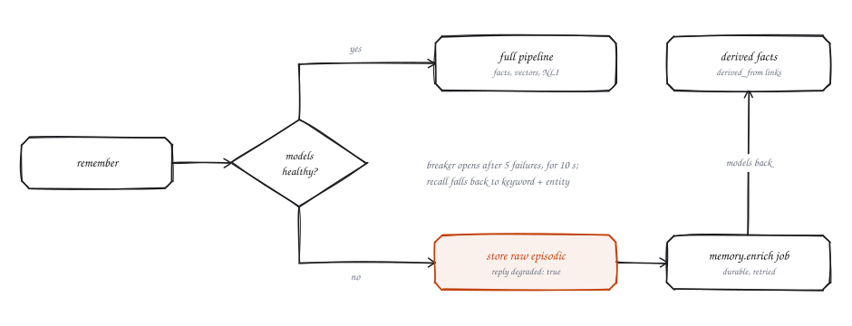

# Run the model service

Mindlog's memory engine uses small local models for the work that needs them. They run in a separate Python process, the **model service**, which the server calls over gRPC. The service is stateless and has no database access. It downloads nothing at runtime, and Mindlog never calls a hosted model API.

## What the models do

| Capability | Model (ONNX Runtime, CPU) | Used for |
|---|---|---|
| Embeddings | all-MiniLM-L6-v2 (384 dimensions) | Vector recall, note linking, the semantic cache, deduplication |
| Entity recognition | GLiNER small v2.1 (int8) | The entity graph, entity retrieval, Personalized PageRank |
| NLI (contradiction) | nli-deberta-v3-xsmall (quantized) | Conflict detection and duplicate detection |
| Rerank | ms-marco-MiniLM-L6-v2 (cross-encoder) | The `full` recall recipe |
| Fact extraction | Heuristic sentence splitter; optionally any local GGUF model | Turning text into atomic facts |
| Summarize | Extractive (sentences nearest the centroid); abstractive with a GGUF model | Consolidation (themes, entity summaries, sleep-time) |

All four model downloads are Apache-2.0 licensed, about 450 MB in total.

## Run it locally



### Download the models (once)

```bash
cd python
uv run --package mindlog-model-service --group download python model_service/scripts/download_models.py
```

The models land in `python/model_service/models/` at pinned revisions.



### Start the service

```bash
uv run python -m model_service          # gRPC on 127.0.0.1:50051
```



### Point the node at it

```bash
MINDLOG_MODELS__ENDPOINT=127.0.0.1:50051 mindlog-server --single-node --data-dir ./data
```

Or in `mindlog.yaml`:

```yaml
models:
  endpoint: 127.0.0.1:50051
  timeoutMs: 2000          # per call
  breakerFailures: 5       # consecutive failures that open the circuit breaker
  breakerOpenMs: 10000     # how long it stays open
```



In Docker, the `dev` compose profile already runs the `model-service` container and wires it up.

## Service settings

| Variable | Default | Meaning |
|---|---|---|
| `MODELS_DIR` | `python/model_service/models` | Where the models are loaded from |
| `MODEL_SERVICE_HOST`, `MODEL_SERVICE_PORT` | `127.0.0.1`, `50051` | Listen address (`0` picks a free port) |
| `MODEL_BATCH_MAX`, `MODEL_BATCH_WAIT_MS` | `32`, `5` | Micro-batching: largest batch, and how long to wait to fill it |
| `MODEL_QUEUE_MAX` | `256` | Items queued per model before the service answers `RESOURCE_EXHAUSTED` |
| `EXTRACT_GGUF` | unset | Path to a local GGUF instruct model for LLM fact extraction (`uv sync --extra llm`) |
| `MODEL_SERVICE_TLS_CA`, `_CERT`, `_KEY` | unset | Mutual TLS; certificates are reloaded when they change |

## When the service is down

Losing the model service lowers quality, not availability:

* writes are stored raw as `episodic` memories, and a durable `memory.enrich` job is queued for each;
* recall uses the keyword and entity retrievers that still work;
* responses carry `degraded: true`;
* when the service is back, the jobs commit the derived facts with `derived_from` links. Each job retries with exponential backoff, for about a minute over five attempts. A job whose retries run out is marked `dead` on the dashboard **Jobs** page, and its raw memory stays recallable by keyword.

<figure><figcaption><p>Degraded mode on the write path.</p></figcaption></figure>

The circuit breaker opens after 5 consecutive failures and probes again after 10 s. The [model-service-down runbook](../runbooks/model-service-down.md) covers diagnosis. The gRPC API is documented in the [Model service reference](../reference/model-service.md).
