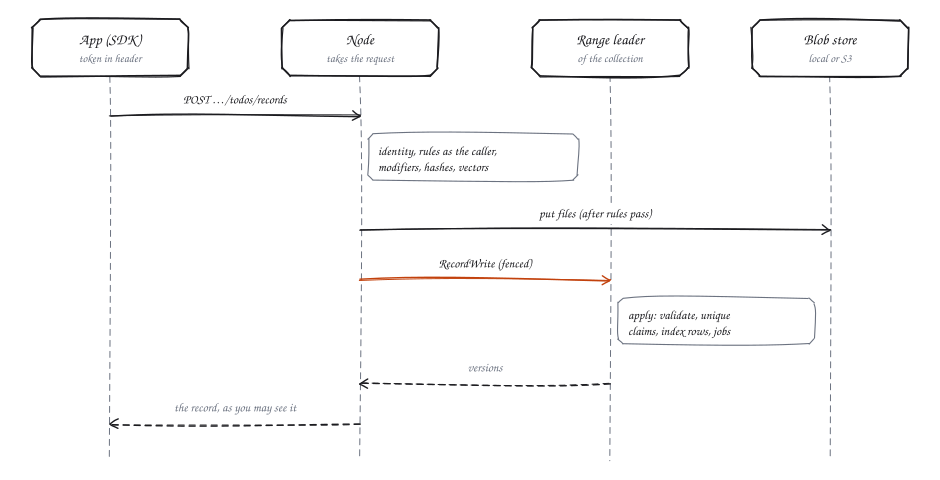

# App backend

Mindlog can be the whole backend of an application. Define **collections** (tables with typed fields), protect them with **rules**, let users **sign in**, upload **files**, and get **realtime** updates. It works like PocketBase, but every write is a replicated Raft command, and the same cluster holds your agents' memory.

| Piece | Guide |
|---|---|
| Schemas, field types, records, views, migrations | [Collections and records](collections.md) |
| Who may list, view, create, update and delete what | [Rules](rules.md) |
| Password, OTP and OAuth2 sign-in; tokens; delegation to agents | [Authentication](authentication.md) |
| Uploads, thumbnails and protected downloads | [Files](files.md) |
| Live record events over SSE | [Realtime](realtime.md) |
| Server-side TypeScript hooks and cron jobs | [Hooks and cron](hooks.md) |

## A complete example

The repository's [`examples/todo-app`](https://github.com/VishvakR/Mindlog/tree/main/examples/todo-app) is a real app on Mindlog alone. It has sign-up and sign-in, per-user todos enforced by rules, file attachments with thumbnails, live updates, and an assistant agent that reads a user's todos through a delegated token.

```bash
pnpm build
mindlog-server superuser upsert admin@example.com 'a long password' --data-dir ./data
MINDLOG_COLLECTIONS__MIGRATIONS_DIR=examples/todo-app/migrations \
  mindlog-server --single-node --data-dir ./data
pnpm --filter todo-app dev
```

From the browser it is a few lines of the [TypeScript SDK](../../sdks/typescript.md):

```ts
import { MindlogClient } from '@mindlog/sdk';

const pb = new MindlogClient(location.origin, { storage: localStorage });
await pb.collection('users').create({ email, password, passwordConfirm: password });
await pb.collection('users').authWithPassword(email, password);
await pb.collection('todos').create({ title: 'milk', user: pb.authStore.record?.id });
const page = await pb.collection('todos').getList(1, 20, { filter: 'done = false', sort: '-created' });
await pb.collection('todos').subscribe('*', (e) => render(e.action, e.record));
```

## How a write flows

<figure><figcaption><p>Creating a record.</p></figcaption></figure>

The node that takes the request checks the rules **as the caller**, applies field modifiers, hashes passwords and computes embeddings. Uploaded files go to the blob store only after the rules pass. It then proposes a `RecordWrite` to the collection's range leader, fenced by the version it read. Apply validates every field and unique constraint, writes index rows and enqueues jobs, all or nothing. Realtime events are filtered against each subscriber's own rules.

## Enabling it

Collections are on by default for every user tenant (`collections.enabled`, `collections.tenants`). Requests that name no tenant (no token claim, no `X-Mindlog-Tenant` header) use `collections.defaultTenant` (`default`).
