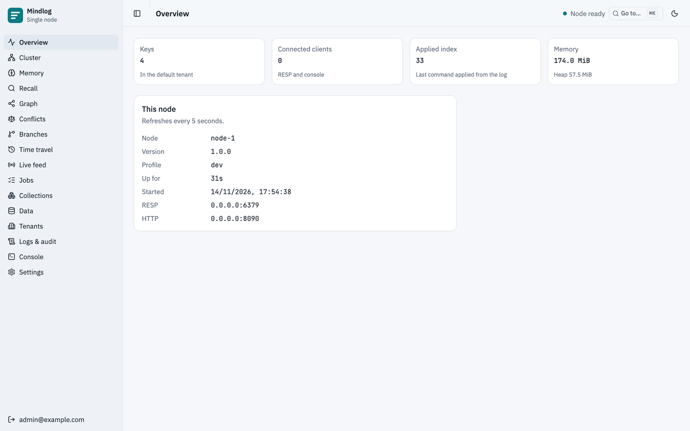
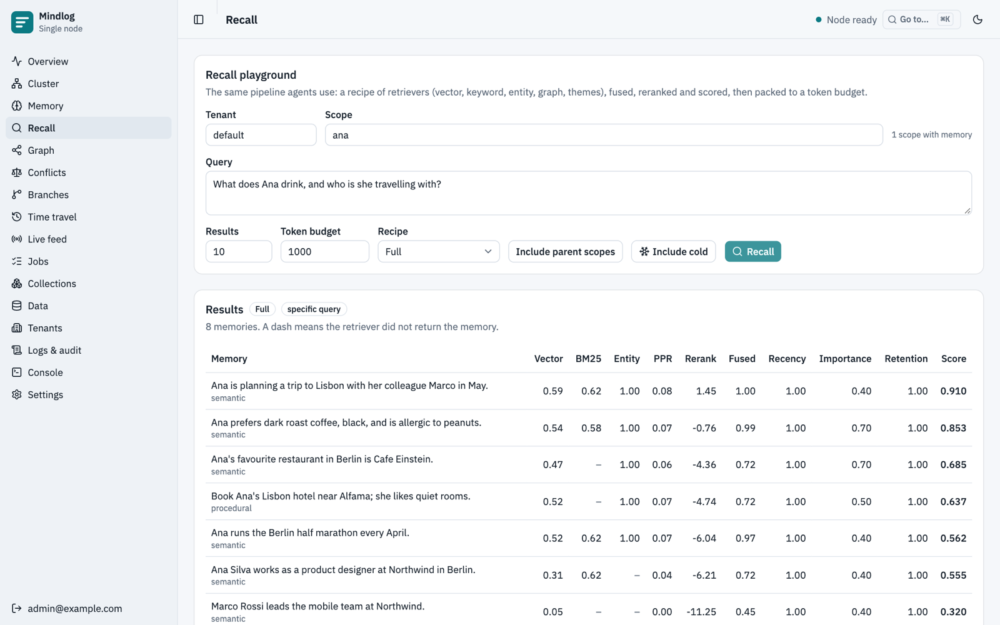
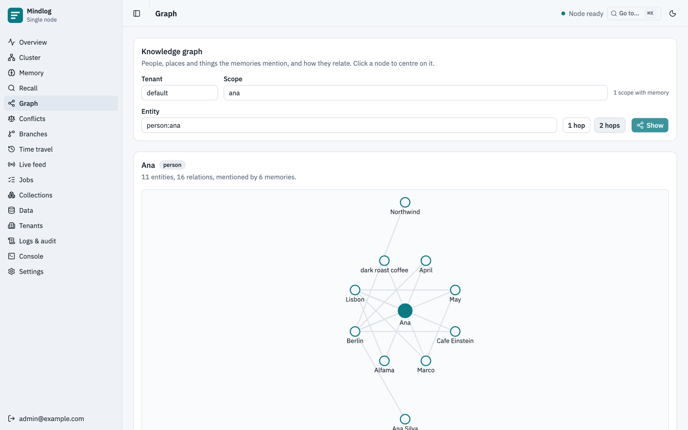
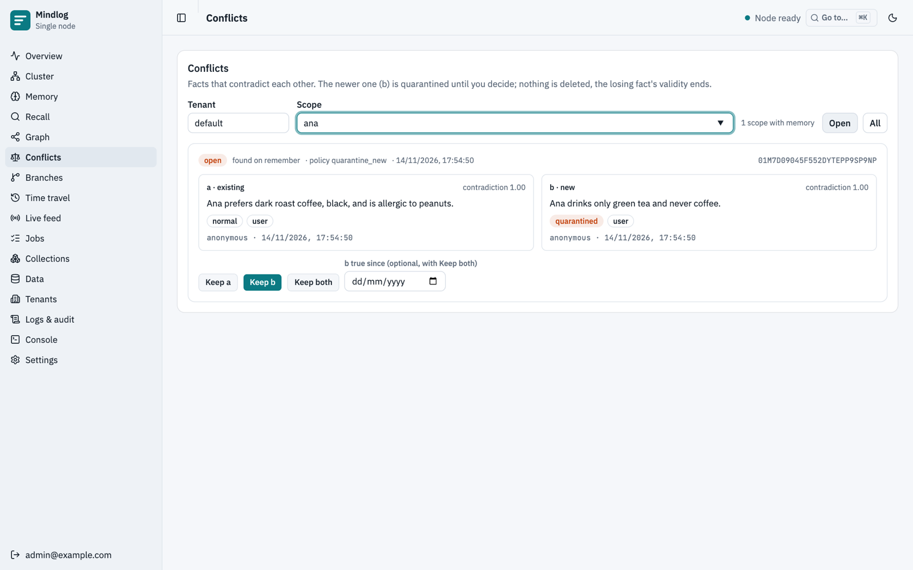

# Dashboard

Every node serves a dashboard at `http://<node>:8090/_/`. Sign in as a superuser (created with `mindlog-server superuser upsert`) or as a tenant member. A member sees only their tenant.

<figure><figcaption>
Overview.
</figcaption></figure>

## Pages

| Page | What it shows and does |
|---|---|
| **Overview** | Keys, connected clients, applied index, memory use; node id, version, profile and listeners |
| **Cluster** | Nodes, ranges, leaders and placement-driver operators, each with its explanation; drain, undrain, remove, transfer leader, split |
| **Memory** | A scope's memories by kind, with trust, tier and history; filters for quarantined and forgotten memories |
| **Recall** | A playground for the recall pipeline: pick a recipe and budget, and see each retriever's score per memory |
| **Graph** | The entity graph around an entity, one or two hops |
| **Conflicts** | Open and resolved contradictions side by side; keep a, b or both |
| **Branches** | A scope's branches, their diff against main, merge (with policy) and drop |
| **Time travel** | A scope as it was at a past time or log index |
| **Live feed** | The change stream of a scope as it happens |
| **Jobs** | Background jobs per scope: queued, leased and dead, with errors and attempts |
| **Collections** | Collection schemas, fields, indexes and rules (with a rule editor that checks and completes), and records |
| **Data** | A key browser for the Redis keyspace: scan, view and edit any type, set TTLs |
| **Tenants** | Tenants, quotas and usage, API keys, members and policies |
| **Logs & audit** | The node's recent logs and the tenant's audit log |
| **Console** | A Redis console in the browser (a RESP connection over WebSocket) |
| **Settings** | The node's effective configuration, with secrets hidden |

## Screenshots

<figure><figcaption>
Recall: each column is one signal, so you can see why a memory ranked where it did.
</figcaption></figure>

<figure><figcaption>
Graph: the entities around Ana, two hops out.
</figcaption></figure>

<figure><figcaption>
Conflicts: the new fact is quarantined until a reviewer decides.
</figcaption></figure>

## Notes

* The dashboard is a static React app served by the node. It uses the same REST API documented in [HTTP API](../api/http.md), so everything it does can be scripted.
* Press **⌘K** / **Ctrl+K** to jump to any page. The moon icon switches dark mode.
* Over plain HTTP, keep the dashboard on a trusted network, or turn on [TLS](../operations/security.md).
