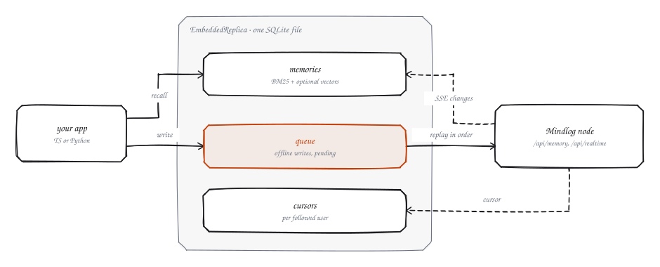

# Embedded replicas (offline)

An **embedded replica** keeps a local copy of one or more memory scopes inside your application process, in a single SQLite file. Recall is local and works offline. Writes made offline are queued and replayed exactly once when the connection comes back. Both SDKs ship one, with the same file format, so a TypeScript app and a Python app can open each other's file.

<figure><figcaption><p>How an embedded replica syncs.</p></figcaption></figure>

## Use it



```ts
import { MindlogClient } from '@mindlog/sdk';
import { EmbeddedReplica } from '@mindlog/sdk/replica';

const client = new MindlogClient('http://localhost:8090');
const replica = EmbeddedReplica.open(client, {
  path: './.mindlog.db',
  users: ['ann'],
  apiKey: 'mlk_…',
  embed: async (texts) => myEmbedder(texts),        // optional: adds vector search
  onRejected: (op, error) => console.warn('dropped', op, error),
});

await replica.remember('ann', 'Ann keeps her passport in the blue drawer.');
const hits = await replica.recall('ann', 'passport');   // local, also while offline
console.log(replica.online, replica.queued);
await replica.settled();                                 // wait for queued work
replica.close();
```



```python
from mindlog.sdk import Client, EmbeddedReplica

client = Client("http://localhost:8090", api_key="mlk_…")
replica = EmbeddedReplica(client, "./.mindlog.db", ["ann"])

ids, queued = replica.remember("ann", "Ann keeps her passport in the blue drawer.")
hits = replica.recall("ann", "passport")      # list[LocalHit]: id, text, kind, score, pending
replica.settled()
replica.close()
```



## How it works

* **Follow.** For each user, the replica opens the scope's [change stream](memory/change-streams.md) from its saved cursor. On the first connect it takes a snapshot (pages of 200). It applies `memory.added` and `memory.evolved` (fetching the records), `memory.forgotten`, and `resync` (snapshot again), and saves the cursor after each.
* **Write online.** The write goes to the server and is stored locally before the call returns, so you read your own writes.
* **Write offline.** The write gets a `local:<requestId>` row marked `pending`, readable at once, and is queued. When the stream reconnects, queued writes replay **in order**, each with its request id, so a retry applies once. A write the server refuses for good (a 4xx) is dropped and reported to `onRejected`.
* **Recall** is local BM25 (k1 1.2, b 0.75). When you pass an `embed` function, it is fused with cosine similarity by reciprocal rank fusion (k = 60).
* Changes, snapshots, replays and your own writes run one at a time, so the local file is always consistent.

## When to use it

* Desktop or edge agents that must keep working on a plane or a flaky network.
* Latency-critical local recall, with the cluster as the durable source of truth.
* Mobile-style sync of one user's memory.

## Limits

* The replica follows whole user scopes. It does not replicate KV data or collections.
* Local recall is simpler than the server's: no entity, graph, theme or rerank retrieval.
* The TypeScript replica needs Node's built-in `node:sqlite`; it does not run in browsers.
