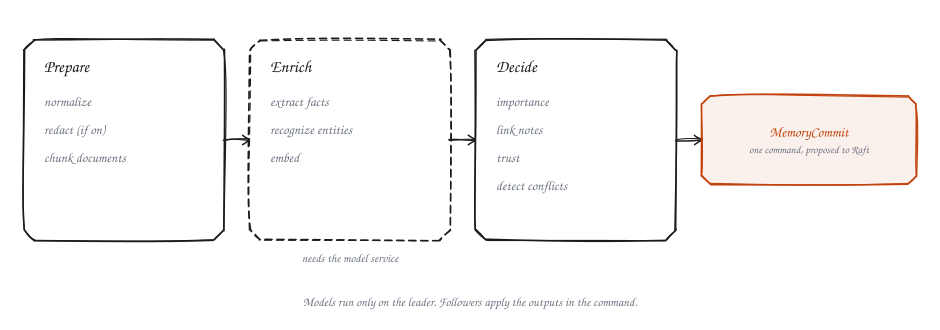
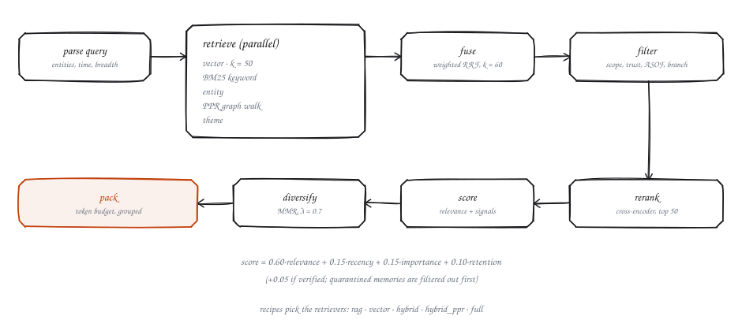

# Agent memory

Mindlog's memory engine turns what agents and users say into durable, searchable memories, and hands the relevant ones back when an agent needs them. It runs inside the database. Every memory operation is a command in the Raft log, every replica holds the same memories and indexes, and decisions such as "this contradicts what we knew" are made once, at commit time.

## The two pipelines

**Remember** turns text into memories: it extracts facts, recognizes entities, embeds, scores importance, links related notes, classifies trust and checks for conflicts. Then it commits everything as one command.

<figure><figcaption>
The remember pipeline.
</figcaption></figure>

**Recall** finds the memories that matter for a query: five retrievers run in parallel, their rankings are fused and filtered, then reranked, scored, diversified and packed into a token budget.

<figure><figcaption>
The recall pipeline.
</figcaption></figure>

## Features

| Feature | What it gives you | Guide |
|---|---|---|
| Fact extraction and entities | Atomic facts linked into a knowledge graph | [Remembering](remember.md) |
| Hybrid recall and packing | Vector + BM25 + entity + graph + theme retrieval, packed to a budget | [Recall and packing](recall.md) |
| Conflict detection | Contradictions caught before commit, handled by policy | [Conflicts](conflicts.md) |
| Provenance and trust | Quarantine for untrusted sources; forget a source and everything derived from it | [Trust and provenance](trust.md) |
| Branches | Isolated memory for a plan or an experiment, merged back with a policy | [Branches](branches.md) |
| Time travel | Recall what was known at a past moment, or what was true at a past time | [Time travel](time-travel.md) |
| Consolidation and forgetting | Background distillation, deduplication, themes, and a forgetting curve with a cold tier | [Consolidation and forgetting](lifecycle.md) |
| Change streams | Follow a scope's changes live, resumable from a cursor | [Change streams](change-streams.md) |
| Portability | Export and import memory archives; record tool calls as procedures | [Import, export and tool traces](portability.md) |
| Semantic cache | Reuse answers to similar prompts, invalidated when their memories change | [Semantic cache](../semantic-cache.md) |

## One API, four interfaces

Every operation is available the same way over each interface:

| Operation | MCP tool | RESP | REST (`POST /api/memory/…`) | SDK |
|---|---|---|---|---|
| Store | `remember` | `MEM.ADD` | `remember` | `remember()` |
| Search | `recall` | `MEM.SEARCH` | `recall` | `recall()` |
| Packed context | `recall` (`context`) | `MEM.PACK` | `pack` | `recall()` → `context` |
| Read one / many | resource `memory://{user}/{id}` | `MEM.GET` | `get`, `getMany`, `list` | `get()`, `getMany()`, `list()` |
| Forget | `forget` | `MEM.FORGET` | `forget` | `forget()` |
| Versions | `history` | `MEM.HISTORY` | `history` | — |
| Entity graph | `graph_query` | — | `graph` | — |

Scopes are written `user[/agent[/session]]` over RESP (`ana`, `ana/planner/s1`) and `{"user", "agent", "session"}` over MCP and REST. An API key pinned to a user can only reach that user's scope.

## Design guarantees

* **Append-only.** Memories are never overwritten. A newer fact closes the older one's validity window, and forgetting sets `expiredAt`. History stays queryable (`MEM.HISTORY`, `ASOF`).
* **Deterministic.** Models run once, on the range leader, before the command is proposed. Followers apply the results; they never re-run a model.
* **One range per user.** All of a user's memory, indexes and jobs share one key prefix, so recall never crosses ranges.
* **Degrades, never fails.** Without the model service, memory still accepts writes and answers recall, and marks responses `degraded: true`.
