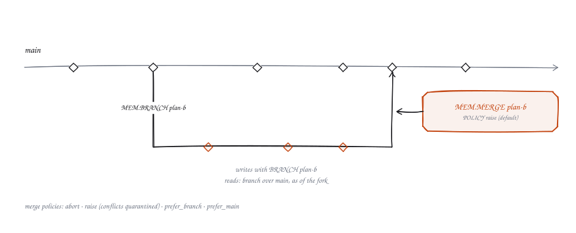

# Branches

A **branch** gives an agent a private copy of a scope's memory to experiment in: plan a trip two ways, let a sub-agent work without polluting the main memory, or test what happens if a fact were different. A branch reads main as it was at the fork, plus its own writes. When the work is done, merge it back or drop it.

<figure><figcaption><p>Fork, write, merge.</p></figcaption></figure>

## Lifecycle



### Create

```bash
MEM.BRANCH ana trip-plan
```
Branch names are 1–64 letters, digits, `.`, `_` or `-`; `main` is the scope itself.



### Write and read on the branch

```bash
MEM.ADD ana "Ana will fly to Porto instead of Lisbon." BRANCH trip-plan
MEM.SEARCH ana "where is Ana flying?" BRANCH trip-plan
MEM.FORGET ana BRANCH trip-plan 01M7…
```
Reads overlay the branch's writes on main **as of the fork**. Later writes to main are not visible on the branch.



### Inspect

```bash
MEM.DIFF ana trip-plan        # added, forgotten and changed memories vs main at the fork
MEM.BRANCHES ana              # name, status (open/merged/dropped), fork index and time, writes
```



### Merge or drop

```bash
MEM.MERGE ana trip-plan POLICY raise
MEM.DROP ana trip-plan
```



The same operations are MCP tools (`branch_create`, `branch_diff`, `branch_merge`, `branch_drop`), REST operations (`branch`, `branches`, `diff`, `merge`, `drop`), and the dashboard **Branches** page.

## Merge policies

The merge is planned on the leader. Every new branch fact is checked against main with NLI, as in [conflict detection](conflicts.md), and the plan is applied as one command. If main has moved since the plan was made, apply refuses it.

| Policy | Branch facts that contradict main |
|---|---|
| `abort` | Nothing is merged if any fact contradicts |
| `raise` (default) | Merged as `quarantined`, with open conflicts for review |
| `prefer_branch` | The branch wins; contradicted main facts get their validity ended |
| `prefer_main` | The contradicting branch facts are rejected; the rest are merged |

Non-contradicting changes merge field by field. Validity, expiry and trust merge three-way, last writer wins by HLC; link weights add up; supporting memories are an add-wins set. The merge reply lists `added`, `rejected` and `conflicts`.

## Limits

* At most 1,000 memories written per branch.
* An open branch pins main's history at its fork version from garbage collection, so drop or merge branches you no longer need.
* Consolidation's sleep-time worker uses branches itself (`sleep-<ms>`): it distils sessions on a branch and merges with `raise`, or drops the branch if it raised more than `memory.consolidation.maxConflicts` (3) contradictions.
