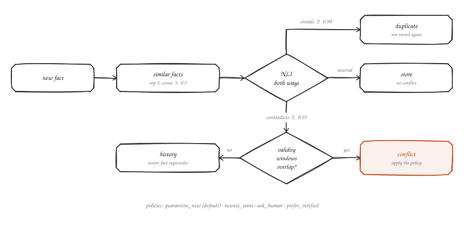

# Conflicts

When an agent learns something that contradicts what it already knows ("Ana is vegetarian" after "Ana's favourite dish is steak"), Mindlog notices **before the fact is committed**. A local NLI (natural-language inference) model decides; the decision and the conflict record are part of the same replicated command.

## How a conflict is detected

<figure><figcaption><p>The conflict decision.</p></figcaption></figure>

1. Each new fact is compared with the 5 most similar existing facts (and facts sharing its entities). Candidates below cosine 0.5 (`memory.conflicts.minSimilarity`) are skipped, so unrelated facts about the same person are not compared.
2. NLI runs in **both directions**.
3. Entailment ≥ 0.90 means a **duplicate**, which is not stored again.
4. Contradiction ≥ 0.95 (`memory.conflicts.threshold`) means a candidate conflict. Then validity decides:
   * if the two facts' validity windows **do not overlap**, it is **history**, not a conflict. A later fact supersedes an open-ended earlier one by closing its `validTo`;
   * if they **overlap**, it is a **conflict**, and the policy applies.

Measured on 320 hand-labelled pairs: F1 0.92 (precision 0.87, recall 0.98).

## Policies

Set `memory.conflicts.policy`:

| Policy | What happens to the new fact |
|---|---|
| `quarantine_new` (default) | Stored as `quarantined`, so it is left out of recall; an open conflict awaits review |
| `newest_wins` | Stored normally; the older fact's validity ends, and the conflict is recorded as already resolved |
| `ask_human` | Stored with its normal trust; an open conflict awaits review |
| `prefer_verified` | A `verified` side wins; otherwise behaves like `quarantine_new` |

Conflicts can also come from [branch merges](branches.md) with the `raise` policy; their `origin` is `merge:<branch>`.

## Review and resolve



```bash
MEM.CONFLICTS ana                 # open conflicts
MEM.CONFLICTS ana ALL LIMIT 20    # include resolved ones
MEM.RESOLVE ana 01M7… KEEP b      # keep the newer fact
MEM.RESOLVE ana 01M7… KEEP both VALID_FROM 2025-06-01
```



```json
{ "name": "conflicts", "arguments": {} }
{ "name": "resolve_conflict", "arguments": { "id": "01M7…", "keep": "b" } }
```



```bash
curl -s localhost:8090/api/memory/conflicts -H "Authorization: Bearer $KEY" \
  -H 'content-type: application/json' -d '{"scope":{"user":"ana"}}'
curl -s localhost:8090/api/memory/resolve -H "Authorization: Bearer $KEY" \
  -H 'content-type: application/json' -d '{"scope":{"user":"ana"},"id":"01M7…","keep":"b"}'
```



A conflict shows both memories (`a` is the existing one, `b` the new one), the contradiction scores in both directions, the policy, its origin and its status.

| `keep` | Result |
|---|---|
| `a` | The existing fact stays; the new one's validity ends |
| `b` | The new fact becomes current (and normal trust); the old one's validity ends |
| `both` | Both stay. With `VALID_FROM`, b replaced a at that world time, so they become history |

Nothing is deleted: the loser's `validTo` is set, so [time travel](time-travel.md) still shows what was believed before. The dashboard **Conflicts** page shows the same queue with side-by-side review.
