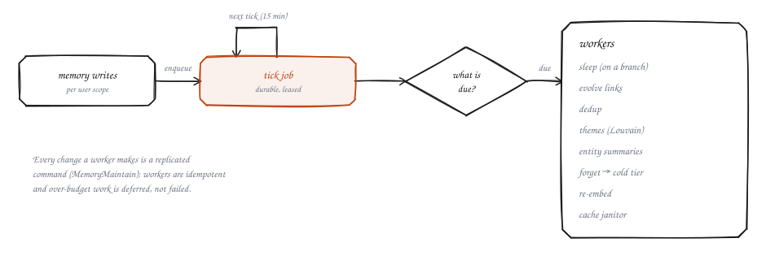
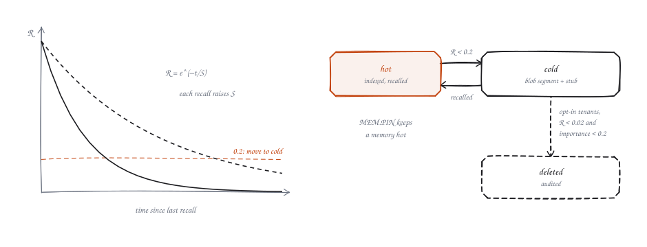
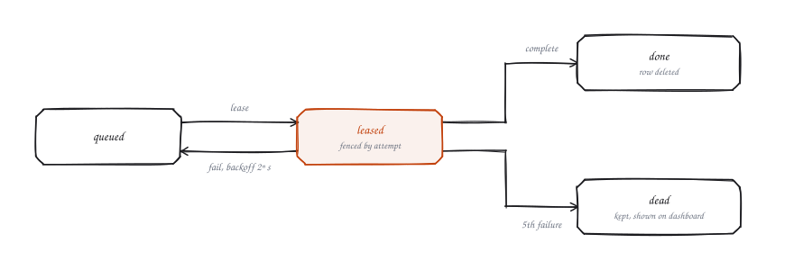

# Consolidation and forgetting

A memory that only grows becomes slow and noisy. Mindlog maintains each scope in the background, much as people consolidate during sleep. It distils sessions into facts, links and deduplicates, builds themes, and lets memories that are never used fade to cheaper storage.

## Consolidation workers

<figure><figcaption><p>The per-scope tick and its workers.</p></figcaption></figure>

The first write to a scope schedules a **tick job** 10 minutes later (`memory.consolidation.idleMs`). After that it ticks every 15 minutes (`tickMs`) while there is work. Each tick runs the workers that are due:

| Worker | When | What it does |
|---|---|---|
| `sleep` | ≥ 20 new memories and 10 min idle, or daily | Distils recent sessions into facts on a `sleep-<ms>` [branch](branches.md), then merges with `raise`, or drops the branch if it raised more than 3 conflicts |
| `evolve` | New linked memories | Refreshes the tags and context of older linked memories, as new versions (A-MEM style) |
| `dedup` | Each tick | Memories with cosine ≥ 0.93 to another get their importance halved and a `duplicate` tag. Nothing is deleted |
| `themes` | The graph grew by > 5% | Louvain communities become `theme` memories, used by the theme retriever |
| `entities` | An entity reaches 5 mentions, or its count doubles | Writes an entity summary |
| `forget` | Hourly | Moves faded memories to the cold tier (below) |
| `reembed` | The embedding model changed | Re-embeds the scope with the new model |
| `cache` | Each tick | Removes expired [semantic cache](../semantic-cache.md) entries |

Every change a worker makes is a replicated command (`MemoryMaintain`). Workers are idempotent and run only on the range leader. Model time is budgeted per tenant per node (`modelSecondsPerHour`, default 600); work over budget is deferred, not failed.

Run workers now, or turn them off:

```bash
MEM.CONSOLIDATE ana                  # all workers
MEM.CONSOLIDATE ana dedup themes     # some
```

```yaml
memory:
  consolidation:
    enabled: false
```

## The forgetting curve

Each memory has a **strength** S, in days, and a **retention** R = e^(−t/S), where t is the time since it was last recalled.

* A new memory starts at S₀ = 1 + 9 × importance (1 to 10 days).
* Each recall strengthens it: S ← S × (1 + 0.5 × min(1, t/S)). Recalling after a longer gap helps more (spaced repetition).

<figure><figcaption><p>Forgetting curve and tiers.</p></figcaption></figure>

| Tier | Meaning |
|---|---|
| **hot** | Indexed and recalled normally |
| **cold** | Retention fell below 0.2 (`memory.forgetting.coldBelow`). The full record moves to the blob store as a compressed segment; a stub with the summary and entity links stays, so graph walks still work. `INCLUDE_COLD` searches it, and recalling a cold memory brings it back hot |
| **deleted** | Only for tenants listed in `memory.forgetting.hardForgetTenants`: retention below 0.02, importance below 0.2, and no hot memory links to it. Audited |

Pinned memories never go cold or get deleted:

```bash
MEM.PIN ana 01M7…
MEM.UNPIN ana 01M7…
```

Turn the cold tier off with `storage.coldTier.enabled: false`.

## Jobs

Enrichment, consolidation and other background work run as **durable jobs** stored in the scope's own range:

<figure><figcaption><p>Job states.</p></figcaption></figure>

* Leasing a job is a replicated command, and only the current lease can complete it. A worker that lost its lease in a leader change cannot finish the job twice.
* Failures retry after 2^attempt seconds. After 5 failed attempts the job is `dead` and stays visible.
* Done jobs are deleted.

```bash
MEM.JOBS ana                        # jobs, plus hot and cold counts for the scope
MEM.JOBS ana STATE dead LIMIT 20
```

The dashboard **Jobs** page shows the same queue for every scope.
