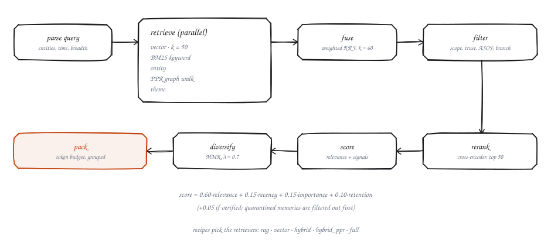

# Recall and packing

## Ask for memories



```bash
MEM.SEARCH ana "what does Ana drink?" K 5
MEM.SEARCH ana/planner "next steps" INHERIT RECIPE hybrid
MEM.PACK ana "plan Ana's trip" BUDGET 800
```



```json
{ "name": "recall",
  "arguments": { "query": "what does Ana drink?", "k": 5, "token_budget": 800 } }
```



```bash
curl -s localhost:8090/api/memory/recall -H "Authorization: Bearer $KEY" \
  -H 'content-type: application/json' \
  -d '{"scope":{"user":"ana"},"query":"what does Ana drink?","k":5,"explain":true}'
```



```python
result = client.memory("ana").recall("what does Ana drink?", k=5, recipe="hybrid")
print(result["context"])
```



### Options

| Option | RESP | REST | Default | Meaning |
|---|---|---|---|---|
| Result count | `K n` | `k` (1–50) | 10 | Ranked items to return. MCP allows 1–20 |
| Token budget | `BUDGET t` | `tokenBudget` (≤ 32,000) | 1,000 | Size of the packed `context`. MCP allows 50–8,000 |
| Recipe | `RECIPE r` | `recipe` | `full` | Which retrievers and stages run (below) |
| Inherit | `INHERIT` | `inherit` | off | Also search the parent scopes: session → agent → user |
| Kinds | — | `kinds` | all | Only these memory kinds |
| Cold tier | `INCLUDE_COLD` | `includeCold` | off | Also search memories moved to the cold tier (slower) |
| Quarantined | — | `includeQuarantined` | off | Include quarantined memories (MCP `include_quarantined`) |
| Explain | — | `explain` | off | Return each retriever's ranked ids and the query route |
| Time travel | `ASOF`, `VALID_AT` | `asOf`, `validAt` | now | See [Time travel](time-travel.md) |
| Branch | `BRANCH b` | `branch` | main | Recall a [branch](branches.md) |

### The response

```json
{
  "items": [
    { "memory": { "id": "01M7…", "kind": "semantic", "text": "Ana prefers dark roast coffee, black.", "trust": "normal", … },
      "score": 0.945,
      "signals": { "fused": 0.98, "keyword": 0.17, "recency": 1.0, "importance": 0.7, "retention": 1.0 } }
  ],
  "context": "## Facts\n- Ana prefers dark roast coffee, black.\n…",
  "tokens": 33, "budget": 1000,
  "groups": [ { "name": "Facts", "ids": ["01M7…"] } ],
  "dropped": [], "compressed": [],
  "recipe": "full", "route": "specific", "degraded": false
}
```

`items` are for code; `context` is ready to put in a prompt. `signals` explain each score.

## How recall works

<figure><figcaption><p>From query to packed context.</p></figcaption></figure>

1. **Parse.** Entities, time hints and breadth are read from the query. The query is routed as `specific`, `multihop` (two or more entities: the graph walk weighs more, ×1.2) or `broad` (no entities: themes weigh more, ×1.5).
2. **Retrieve in parallel**, 50 candidates each:
   * **vector**: exact cosine over the scope's embeddings;
   * **keyword**: BM25 (k1 1.2, b 0.75) with stemming and stop words;
   * **entity**: memories that mention the query's entities;
   * **PPR**: Personalized PageRank over the entity–memory graph (damping 0.5, at most 5,000 nodes), seeded by the query's entities;
   * **theme**: community summaries made by consolidation.
3. **Fuse** the rankings with weighted reciprocal rank fusion (k = 60).
4. **Filter** by scope, branch, trust, validity and `ASOF`. Quarantined memories go here, unless asked for.
5. **Rerank** the top 50 with a cross-encoder (`full` recipe only).
6. **Score**:

   `score = 0.60·relevance + 0.15·recency + 0.15·importance + 0.10·retention`, plus 0.05 for verified memories.

   * relevance is the fused rank, or the rerank score, min-max normalised;
   * recency is `0.995^hours` since the memory was last accessed;
   * retention is `e^(−t/S)` from the [forgetting curve](lifecycle.md).
7. **Diversify** with maximal marginal relevance (λ = 0.7), so near-duplicates do not crowd out other facts (`full` recipe).
8. **Pack** into the token budget, below.

Each recall also bumps the returned memories' recall statistics (batched every 2 s), which strengthens them against forgetting.

## Recipes

| Recipe | Retrievers | Rerank, MMR | Use when |
|---|---|---|---|
| `rag` | vector | no | A baseline: relevance only, no recency, importance or retention |
| `vector` | vector | no | Semantic search with Mindlog's scoring |
| `hybrid` | vector, keyword, entity | no | Fast, strong default for latency-sensitive agents |
| `hybrid_ppr` | hybrid + PPR | no | Questions that hop across entities |
| `full` (default) | hybrid + PPR + theme | yes | Best quality. Rerank adds 0.4–1.4 s at p95 |

On LongMemEval_s, `hybrid_ppr` reached recall_any@10 0.94 against 0.87 for `vector`; on LoCoMo, `full` reached 0.712, `hybrid` 0.613 and `vector` 0.525. See [Evaluations](../../evals/README.md).


In degraded mode, the vector, PPR and rerank stages are skipped and recall runs on keyword and entity matches. Responses say `degraded: true`.


## Packing

`MEM.PACK` and the `context` field of every recall fit the best memories into a token budget (tokens estimated as characters ÷ 4):

* Memories are chosen greedily by score per token. One that no longer fits is shortened to its leading sentences, and a final swap pass looks for a better use of the space.
* The output is grouped under headings: **Facts** (semantic), **Themes**, **Procedures**, and **Recent episodes** (episodic, working, tool traces).
* The packed text never exceeds the budget. `dropped` and `compressed` say what did not fit whole.

## The entity graph

```bash
curl -s localhost:8090/api/memory/graph -H "Authorization: Bearer $KEY" \
  -H 'content-type: application/json' \
  -d '{"scope":{"user":"ana"},"entity":"place:lisbon","depth":2}'
```

Entities are identified as `type:normalized name`. MCP `graph_query` and the dashboard **Graph** page walk one or two hops from an entity.
