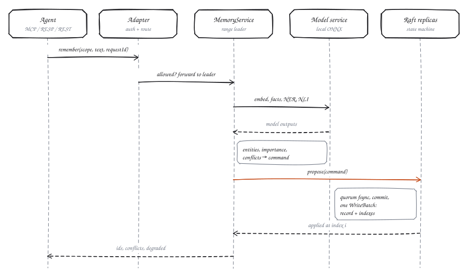
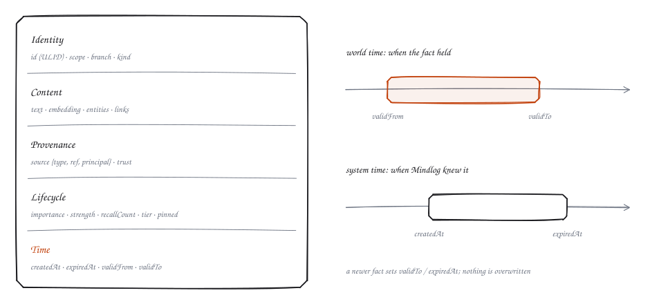
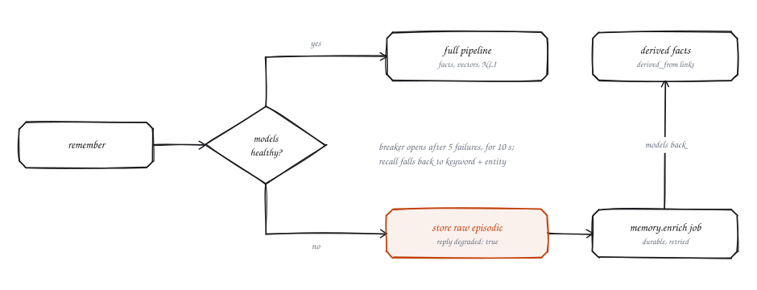

# Remembering

## Store something



```bash
MEM.ADD ana "Ana prefers dark roast coffee, black. She is allergic to peanuts."
MEM.ADD ana/planner "Book the 9:40 train" KIND procedural SOURCE agent
MEM.ADD ana "Ana lives in Berlin" VALID_FROM 2024-03-01 ASYNC
```



```json
{ "name": "remember",
  "arguments": { "content": "Ana prefers dark roast coffee, black.", "source": "user" } }
```



```bash
curl -s localhost:8090/api/memory/remember -H "Authorization: Bearer $KEY" \
  -H 'content-type: application/json' -d '{
    "scope": {"user": "ana"},
    "content": "Ana prefers dark roast coffee, black.",
    "tags": ["preferences"],
    "meta": {"channel": "chat"},
    "requestId": "c0ffee-1"
  }'
```



```ts
const { ids, degraded } = await memory.remember('Ana prefers dark roast coffee, black.', {
  tags: ['preferences'],
});
```



### Options

| Option | RESP | REST / MCP | Meaning |
|---|---|---|---|
| Kind | `KIND k` | `kind` | Store the text verbatim as this kind instead of extracting facts: `episodic`, `semantic`, `procedural`, `working`, `theme`, `tool_trace` |
| Source | `SOURCE s` | `source` (`{type, ref}` in REST) | `user`, `agent`, `tool`, `web`, `document`, `system`, `consolidation`. Decides trust ([Trust](trust.md)) |
| Validity | `VALID_FROM t`, `VALID_TO t` | `validFrom`, `validTo` (`valid_from`, `valid_to` in MCP) | World time the fact became, or stopped being, true. ISO 8601 date, date-time, or ms |
| Branch | `BRANCH name` | `branch` | Write to a [branch](branches.md) instead of main |
| Async | `ASYNC` | `async` | Acknowledge at once and enrich in the background |
| Tags, meta | — | `tags` (≤ 20), `meta` (object) | Free-form labels and data kept on the record |
| Request id | — | `requestId` | Idempotency: the same id applies once, so retries and offline replays are safe. The SDKs set one for you |

Text is limited to 64 KB per call.

## What happens to the text



### Prepare
The text is normalized (each item capped at 32 KB). PII is redacted (emails, phone numbers, ID numbers, Luhn-valid card numbers) if the tenant turned redaction on. Documents are chunked into ~300-token pieces with 15% overlap.



### Enrich (needs the model service)
Facts are extracted (add-only: the extractor never edits existing memories). Entities are recognized: person, organization, place, product, project, date and event. Then each memory is embedded.



### Decide
* **Importance** starts at 0.4. Strong statements add 0.3, first-person statements 0.1, procedural memories 0.1, and text under 15 characters loses 0.1.
* **Links:** up to 5 existing memories with cosine ≥ 0.75 become `related` links.
* **Trust** is classified from the source.
* **Conflicts:** each new fact is checked against similar facts ([Conflicts](conflicts.md)).



### Commit
Everything, including model outputs, ids and timestamps, goes into one `MemoryCommit` command. It is replicated, then applied on every replica in one write batch: the records, vector rows, BM25 postings, entity edges, links and any conflict records.



The response lists the new `ids` and `memories`, and reports `degraded` and, for async or degraded writes, the background `jobId`.

<figure><figcaption><p>A remember call, end to end.</p></figcaption></figure>

## The memory record

<figure><figcaption><p>Anatomy of a memory record.</p></figcaption></figure>

| Group | Fields |
|---|---|
| Identity | `id` (ULID), `user` / `agent` / `session`, `branch`, `kind` |
| Content | `text`, embedding (model id, dimensions, vector), `entities`, `links` (`related`, `supports`, `derived_from`, `supersedes`, `contradicts`), `tags`, `meta` |
| Provenance | `source {type, ref, principal}`, `trust` |
| Lifecycle | `importance` (0–1), `strength` (days), `recallCount`, `lastRecalledAt`, `tier` (hot/cold), `pinned`, `version` |
| Time | `validFrom` / `validTo` (world time), `createdAt` (commit HLC), `expiredAt` (when it was superseded or forgotten) |

### Four timestamps

Following Graphiti's model, Mindlog separates **world time** (when a fact was true) from **system time** (when Mindlog knew it). "Ana lived in Berlin from 2024 to 2025" has a world-time window. The day you learned she moved, the old fact's `validTo` is set; it is not deleted. That is what makes [time travel](time-travel.md) and history-aware [conflict detection](conflicts.md) possible.

## Forgetting

```bash
MEM.FORGET ana 01M7CZRQD0QY7ACAV1YM7S7J7F          # by id
MEM.FORGET ana SOURCE https://example.com/post     # a source and everything derived from it
```

Forgetting is append-only. The record gets `expiredAt`, disappears from recall and listings, and stays in history. It also drops any [cached answers](../semantic-cache.md) that depended on it, in the same write. Deleting data for good is a separate, audited path: hard forgetting in the [lifecycle](lifecycle.md), or tenant purge.

## Degraded mode

When the model service is unavailable (not configured, down, or slower than `models.timeoutMs`):

* the text is stored as-is, as one `episodic` memory, and the response says `degraded: true`;
* a durable `memory.enrich` job is queued in the scope's range. It retries with exponential backoff (2, 4, 8, 16, 32 s). If models return in that window, it commits the derived facts with `derived_from` links. After five failed attempts the job is marked `dead` and shown on the dashboard **Jobs** page;
* the raw memory stays recallable through keyword and entity matching.

<figure><figcaption><p>Degraded mode.</p></figcaption></figure>

`ASYNC` uses the same job to acknowledge first and enrich after. When a scope already holds 1,000 queued jobs, writes return `BUSY`.
