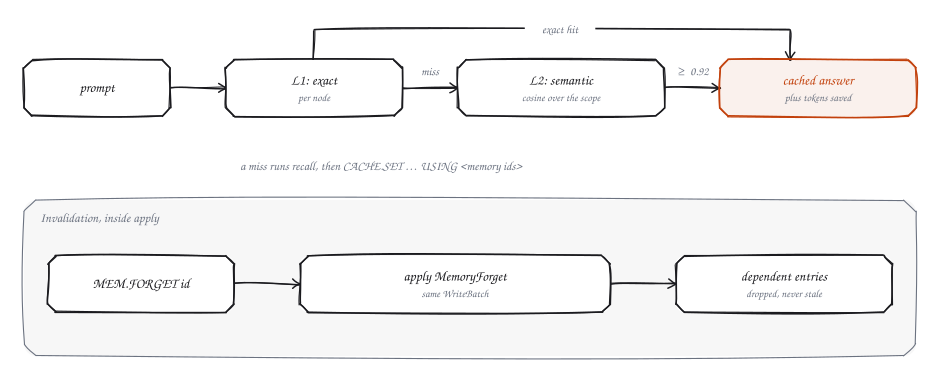

# Semantic cache

LLM calls are slow and expensive, and agents often ask the same thing in different words. The semantic cache stores an answer against a prompt. A later prompt that **means** the same thing gets the stored answer back.

A cached answer goes stale when its facts change. So each entry records the **memories the answer was derived from**, and forgetting any of them drops the entry inside the same replicated write. There is no window in which a stale answer can be served.

<figure><figcaption><p>Lookup and invalidation.</p></figcaption></figure>

## Use it



```bash
# after answering with recall, store the answer and the memory ids it used
CACHE.SET ana "what coffee does Ana like?" "Dark roast, black." USING 01M7CZRQ… TTL 86400
CACHE.GET ana "what kind of coffee does Ana like?"
# → id 01M7… answer "Dark roast, black." similarity 0.982 level l2 using 01M7CZRQ…
CACHE.GET ana "what kind of coffee does Ana like?" THRESHOLD 0.99    # → nil
CACHE.DEL ana 01M8…
```



```json
{ "name": "cache_lookup", "arguments": { "prompt": "what kind of coffee does Ana like?" } }
{ "name": "cache_store",
  "arguments": { "prompt": "what coffee does Ana like?", "answer": "Dark roast, black.",
                 "depends_on": ["01M7CZRQ…"], "ttl_seconds": 86400 } }
```



The cache is available over RESP and MCP; it has no REST endpoint.

## How lookup works

1. **L1**: a per-node map on the exact normalised prompt. Free, and local to the node.
2. **L2**: a cosine scan over the scope's replicated entries, using the prompt's embedding. A candidate at or above the threshold (default **0.92**) is confirmed by an evaluator before it counts as a hit.

A hit reports its `similarity` and `level` (`l1` or `l2`), and the memory ids it depends on.

Without an embedder (degraded mode), only exact prompts match.

## Invalidation

* `CACHE.SET … USING id…` records the memory ids an answer depends on.
* Forgetting one of those memories (by id or by [source cascade](memory/trust.md)) drops every dependent entry in the same apply.
* Storing an entry that names an already-forgotten memory is refused.
* `TTL` (up to 30 days) expires entries; the consolidation `cache` worker removes them.

## Limits and numbers

* At most 1,000 entries per scope; the oldest is evicted first.
* Prompts up to 4 KB, answers up to 64 KB.
* At threshold 0.92, the false-hit rate measured 1.4% (target < 2%).
* Metrics: `mindlog_cache_lookups_total{result}` and `mindlog_cache_tokens_saved_total`.
