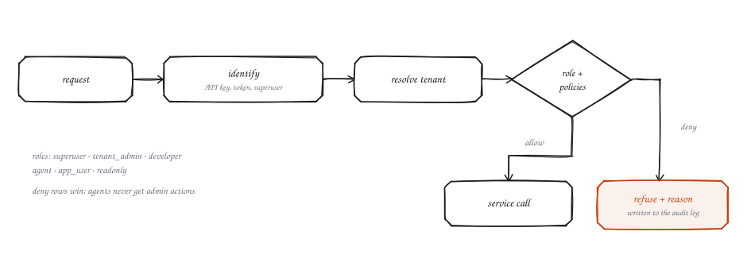

# Tenants and access control

A **tenant** is an isolated customer, team or application. Every key in storage starts with its tenant, and every request resolves a tenant before it reaches storage. Tenants have their own API keys, dashboard members, policies, quotas, audit log and encryption key.

## Tenants

Superusers manage the registry:

```bash
curl -s localhost:8090/api/tenants -H "Authorization: Bearer $SUPERUSER_TOKEN" \
  -H 'content-type: application/json' -d '{
    "name": "acme",
    "quotas": { "memories": 1000000, "writeQps": 200, "recallQps": 50 },
    "redaction": { "enabled": true, "kinds": ["email", "phone", "id", "card"] },
    "auditRetentionDays": 90
  }'
```

| Endpoint | Purpose |
|---|---|
| `GET / POST /api/tenants` | List, create |
| `GET / PATCH / DELETE /api/tenants/:t` | Read; change settings (redaction, audit retention); delete |
| `PUT /api/tenants/:t/quotas`, `GET …/usage` | Quotas (superuser only) and current usage |
| `GET / PUT /api/tenants/:t/policies` | Policy rows |
| `GET / POST /api/tenants/:t/keys`, `DELETE …/keys/:id` | API keys |
| `GET / PUT /api/tenants/:t/members`, `DELETE …/members/:email` | Dashboard accounts limited to this tenant |
| `GET /api/tenants/:t/audit` | The audit log (`limit`, `cursor`) |
| `POST / GET /api/tenants/:t/export` | Start and check a data export |

The dashboard **Tenants** and **Logs & audit** pages cover the same ground. Tenant names are letters, digits, `_`, `.` and `-`; system tenant names are reserved.

## Roles

<figure><figcaption><p>How a request is authorized.</p></figcaption></figure>

| Role | May | Typical holder |
|---|---|---|
| `superuser` | Everything, across tenants (quotas, tenant create and delete, cluster) | Operators |
| `tenant_admin` | Read, write and administer one tenant: keys, members, policies, settings, collections, audit, export | Team leads |
| `developer` | Read and write memory, KV and collections | Developers, backend services |
| `agent` (default for keys) | `memory.read`, `memory.write` only | AI agents |
| `readonly` | Read memory, KV, collections and tenant info | Dashboards, analysts |
| `app_user` | Nothing directly; reaches data only through [collection rules](app-backend/rules.md) | Signed-in app users |

The actions roles grant are `memory.read`, `memory.write`, `kv.read`, `kv.write`, `collections.read`, `collections.manage`, `tenant.read`, `tenant.settings`, `keys.manage`, `members.manage`, `policies.manage`, `audit.read`, `data.export`, plus the superuser-only `tenant.quotas`, `tenant.create`, `tenant.delete`, `cluster.read` and `cluster.admin`.

## Policies

Per-tenant **policy rows** refine the built-in roles. They are replicated data, not configuration:

```json
{ "policies": [
  { "effect": "deny",  "subject": "agent", "actions": ["memory.write"], "scopes": ["finance-*"] },
  { "effect": "allow", "subject": "apikey:5932e0101281d073", "actions": ["kv.read"] }
] }
```

* `subject` is a role name or a principal such as `apikey:<id>`.
* `scopes` limits a row to memory scope patterns (`*` at the end matches any suffix).
* **Deny wins** over allow. No row can cross tenants, reach a system tenant, grant a superuser-only action, or give an agent an admin action.
* Every refusal carries a reason, is returned to the caller as `PERMISSION_DENIED`, and is written to the audit log.

## API keys

```bash
curl -s localhost:8090/api/tenants/acme/keys -H "Authorization: Bearer $TOKEN" \
  -H 'content-type: application/json' \
  -d '{"name":"support-bot","user":"ana","role":"agent","scopes":["ana*"],"expiresAt":1830000000000}'
```

| Field | Meaning |
|---|---|
| `name` | A label |
| `user` | Pins the key to one memory user scope; absent means every user of the tenant |
| `role` | Any tenant role (default `agent`) |
| `scopes` | Memory scope patterns the key is limited to |
| `expiresAt` | Expiry, in ms since the epoch |

The key (`mlk_…`) is returned once and stored hashed. Use it as `Authorization: Bearer mlk_…` (HTTP, MCP) or `AUTH mlk_…` (RESP). With the node stopped, `mindlog-server apikey create | list | revoke` does the same for bootstrapping.

## Quotas and rate limits

| Quota | Limits |
|---|---|
| `storageBytes`, `keys`, `memories` | Size; over-limit writes get `QUOTA_EXCEEDED` |
| `writeQps`, `recallQps` | Request rate; excess gets `RATE_LIMITED` (retryable) |
| `modelSecondsPerHour` | Model time for the tenant's background work |
| `connections` | Concurrent connections |

All quotas are unlimited unless set. Deletes and forgets are always allowed, so a full tenant can make room. Usage is sampled about every 30 s. Rate limits are token buckets per tenant and class, with the cluster-wide budget split across nodes by the placement driver.

## Audit log

Sign-ins, denials, key and member changes, policy and settings changes, exports, deletions and purges are recorded with the principal, the acting agent (for delegated tokens), the action, the resource, the result and the reason. Entries are written through a range-local outbox, so an audit record commits with the change it describes. Retention is per tenant (`auditRetentionDays`).

## PII redaction

With `redaction.enabled` on a tenant, the remember pipeline replaces emails, phone numbers, ID numbers and Luhn-valid card numbers (`kinds`) before anything is embedded or stored.

## Export and deletion

* **Export:** `POST /api/tenants/:t/export` writes a gzipped NDJSON archive of the tenant's KV data, memories and collections to the blob store (`exports/<t>/<id>.ndjson.gz`). `GET` reports progress.
* **Deletion:** `DELETE /api/tenants/:t` refuses the tenant's requests at once. After `tenancy.deleteGraceMs` (one day) every range holding the tenant's keys is purged, its blobs are deleted and, with encryption at rest, its data key is destroyed (crypto-shredding). There is no undelete.


Backups taken before a deletion still contain the tenant until they age out (`backup.keep`). The [runbook](../runbooks/tenant-export-delete.md) covers the full procedure.


## Large tenants: semantic split

A single user scope normally lives in one range. With `features.semanticSplit: true`, a scope that grows past `memory.split.maxMemories` (100,000) is split by k-means into up to 8 clusters, each its own sub-scope, and recall searches the nearest `memory.split.recallClusters` (2). This trades 4–7 points of recall@10 for bounded range size.
