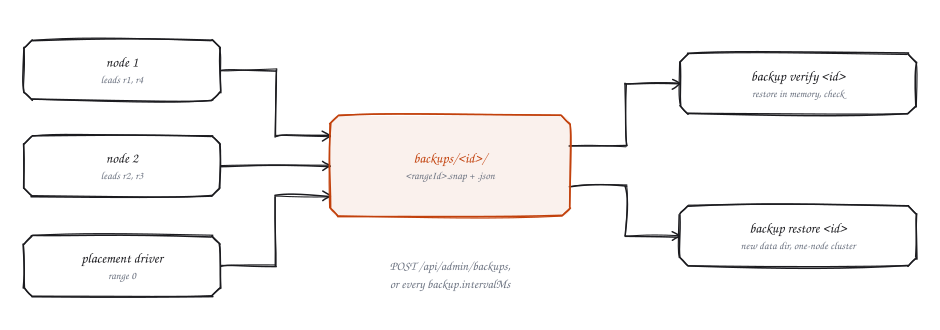

# Backups and restore

Mindlog takes **full backups** from range snapshots. Each node writes the snapshot of every range it currently leads (the placement driver's range 0 included) to the blob store, with a manifest per range.

<figure><figcaption><p>Backup, verify, restore.</p></figcaption></figure>

## Taking backups

**On a schedule:**

```yaml
backup:
  intervalMs: 3600000     # hourly; 0 = off
  keep: 7                 # backups kept
  verify: true            # restore the previous backup in memory after each one
blob:
  default: { type: s3, endpoint: https://s3.example.com, bucket: mindlog-backups,
             accessKeyId: '${file:/run/secrets/s3-id}', secretAccessKey: '${file:/run/secrets/s3-secret}' }
```

**On demand** (superuser):

```bash
curl -s -X POST localhost:8090/api/admin/backups -H "Authorization: Bearer $TOKEN" \
  -H 'content-type: application/json' -d '{"id":"20261114T120000Z"}'
```

Send the same `id` to every node, so that all ranges land under one backup. The reply lists the ranges this node led and wrote. Backups appear under `backups/<id>/<rangeId>.snap` and `<rangeId>.json`. Backup ids are times (`20261114T120000Z`).


Use an S3-compatible store for clusters. With a local blob store, each node writes its own ranges to its own disk, and you must collect every node's `blobs/backups/<id>/` before restoring.


## Verifying

```bash
mindlog-server backup verify 20261114T120000Z [-c mindlog.yaml] [--from <data-dir>]
```

This restores the backup into memory and checks sizes, checksums and keyspace coverage. A backup taken during a split or merge is refused; use the next one. `backup.verify: true` does this automatically after each scheduled backup, on range 0's leader. Results are counted in `mindlog_backup_verify_total`.

## Restoring

```bash
mindlog-server backup restore 20261114T120000Z --data-dir /var/lib/mindlog-restored [--from <old-data-dir>]
mindlog-server --single-node --data-dir /var/lib/mindlog-restored
```

The restore refuses a non-empty directory. The restored node is the only voter of every range, and the PD's range directory refills from heartbeats. To grow back to a cluster, start new nodes with `cluster.join: true`, and the PD re-replicates onto them. Use the same `storage.encryption.masterKey` the backup was written with. The full procedure is in the [restore runbook](../runbooks/restore-from-backup.md).

## Limits

* Each range is restored at its own backup point. There is no point-in-time restore and no cut that is consistent across ranges.
* Cold-tier segments and files deleted after the backup are gone.
* Backups keep deleted tenants until they age out of `backup.keep`.
