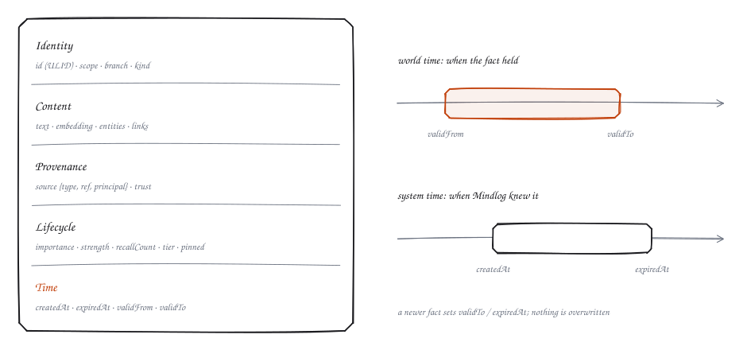

# Key concepts

## Data model

**Tenant.** The top-level isolation boundary. Every key starts with its tenant, so tenants never share a range, and every request resolves a tenant before it touches storage. API keys, accounts, quotas, policies and the audit log are per tenant. A single-node install uses the tenant `default`. See [Tenants and access control](../guides/tenants-and-access.md).

**Scope.** Where a memory lives inside a tenant: `user`, optionally narrowed to `user/agent` and `user/agent/session`. Over RESP a scope is one argument, `alice` or `alice/planner/s1`; over MCP and REST it is `{user, agent, session}`. The empty user `''` is the tenant-wide scope. All of a user's memory is stored under one key prefix, so it always lives in one range and recall touches one range.

**Memory record.** An append-only record with an id (ULID), a kind, text, an embedding, entities, links to other memories, provenance, trust, lifecycle signals and four timestamps. Facts are never overwritten: a newer fact closes the older one's validity window. See [Remembering](../guides/memory/remember.md).

<figure><figcaption>
Anatomy of a memory record.
</figcaption></figure>

**Kinds.** `semantic` (facts), `episodic` (raw events and conversation), `procedural` (how-to), `working` (short-term), `theme` (a community summary made by consolidation), `tool_trace` (a recorded tool call).

**Sources and trust.** Every memory records where it came from: `user`, `agent`, `tool`, `web`, `document`, `system` or `consolidation`. Its trust is `verified`, `normal` or `quarantined`. Quarantined memories are left out of recall unless asked for. See [Trust and provenance](../guides/memory/trust.md).

**Collection and record.** In app-backend mode, a collection is a schema (fields, indexes, rules) and a record is a row in it. Auth collections hold users who can sign in. See [Collections](../guides/app-backend/collections.md).

## Memory engine

**Remember.** The write path: normalize, optionally redact, extract facts, recognize entities, embed, score importance, link related notes, classify trust and detect conflicts. All the results go into one `MemoryCommit` command.

**Recall.** The read path: several retrievers run in parallel, their rankings are fused, filtered, optionally reranked, scored, diversified and packed into a token budget.

**Recipe.** A named recall configuration: `rag`, `vector`, `hybrid`, `hybrid_ppr` or `full` (the default). See [Recall and packing](../guides/memory/recall.md).

**Conflict.** A new fact that a local NLI model says contradicts an existing fact whose validity window overlaps. What happens next is set by the conflict policy. See [Conflicts](../guides/memory/conflicts.md).

**Branch.** A named, isolated line of memory for a scope. It reads main as of the fork and adds its own writes, and can be merged back with a policy. See [Branches](../guides/memory/branches.md).

**Degraded mode.** What Mindlog does when the model service is unavailable: writes are stored raw and enriched later by a durable job, recall uses the retrievers that still work, and responses carry `degraded: true`.

**Consolidation.** Background workers per scope that distil sessions, refresh links, deduplicate, build themes, summarise entities, move faded memories to the cold tier and re-embed after a model change. See [Consolidation and forgetting](../guides/memory/lifecycle.md).

## Cluster

**Raft log.** The single source of truth. A write becomes a command, is replicated to a majority, then applied in order on every replica. Apply is deterministic: it never reads the clock, randomness, the network or a model.

**Range.** A contiguous slice of the keyspace, replicated by its own Raft group (three replicas by default). Ranges split above 64 MiB or when they stay hot, and merge when small. Many ranges share each node.

**Leader.** The replica of a range that accepts proposals and serves lease reads. Requests that reach another node are forwarded to it.

**Placement driver (PD).** A small Raft group (range 0) that keeps the range directory, hands out unique ids and timestamps (TSO), and schedules splits, merges, repairs and rebalancing. A single node runs its own one-voter PD.

**HLC.** A hybrid logical clock. Commands carry an HLC timestamp, and MVCC versions are per-range HLC timestamps, which is what makes `ASOF` reads possible.

**Cluster version.** New command types are gated by a cluster version, so a rolling upgrade never sends a command an older node cannot apply.

## Glossary of interfaces

| Term | Meaning |
|---|---|
| RESP | The Redis wire protocol (versions 2 and 3). Mindlog speaks it on `:6379` |
| MCP | The Model Context Protocol, how AI hosts call tools. Mindlog serves it on `127.0.0.1:8765/mcp` |
| `mlk_…` | An API key. Sent as `Authorization: Bearer mlk_…` (HTTP, MCP) or `AUTH mlk_…` (RESP) |
| Superuser | An operator account in the system tenant, used for the dashboard and admin APIs |
